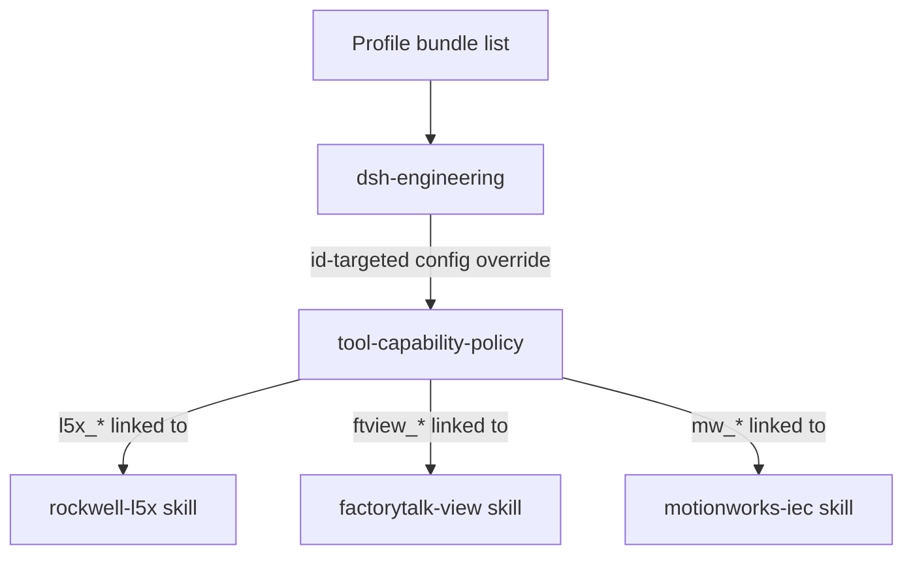
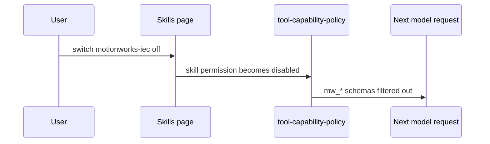
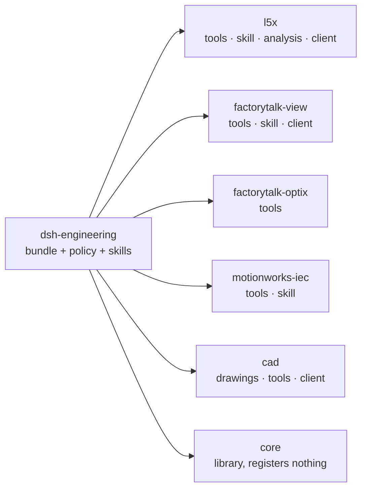

# dsh-engineering

One built-in engineering plugin for AryaAI: the Studio 5000, FactoryTalk View, FactoryTalk Optix, MotionWorks IEC and CAD plugins composed behind a single install surface, with one place where their tool exposure is decided.

## Status

**Phase 1 is functionally complete.** The bundle ships a single loader patch entry that links each engineering tool namespace to the skill that governs it. It inserts no plugin rows, so it can be added to a profile that already mounts the product plugins without duplicating a registration. The contract test and a composed-config dump verify it; the Skills-page toggle still needs a live smoke check (see Known gaps).

The product plugins still mount independently. Porting them into this repository, flipping the bundle to installer distribution, and retiring the standalone packages are the phases below, not something this release does.

## How the bundle composes

Phase 1 adds one layer after `@deepseek-ai/dsh-web-app` and patches a row that layer already inserts:



The composed config labels the row `# == @deepseek-ai/dsh-web-app, patched by dsh-engineering` and contains exactly one `tool-capability-policy` entry.

## What the policy changes

| Skill | Tools it governs | Switch off |
|---|---|---|
| `rockwell-l5x` | `l5x_*` | schemas and guidance both leave the request |
| `factorytalk-view` | `ftview_*` | schemas and guidance both leave the request |
| `motionworks-iec` | `mw_*` | schemas and guidance both leave the request |
| — | `optix_*` | unlinked; always visible |

Before this bundle, a skill switch changed only the guidance; the tool schemas stayed exposed.



`optix_*` is deliberately unlinked. There is no FactoryTalk Optix skill, and linking tools to a skill that never registers would hide them permanently rather than gate them.

`onDemand` stays `false`. Arya measured bounded on-demand discovery against eager exposure and kept eager exposure because discovery cost more turns than the schema characters it saved. Changing that is a product decision, not a bundle side effect.

## What phase 1 does not do

- It does not reduce the size of any tool schema.
- It does not compose the product plugins; their rows still come from their own bundles.
- It does not fold the L5X ladder viewer into the L5X package.
- It does not change a single product entry id or enable state.

Measured with `name` + `description` + `parameters` serialized per tool:

| Plugin | Tools registered | Schema characters | Approx. tokens |
|---|---|---|---|
| MotionWorks IEC 0.7.0 | 61 | 55,808 | 14.0k |
| L5X 0.6.2 | 43 | 20,400 | 5.1k |
| FactoryTalk View 0.3.0 | 11 | 5,671 | 1.4k |

The per-product switches now make that cost controllable; shrinking it is product-repository work.

## Install in a development profile

Link the checkout into the profile and list the bundle **after** `@deepseek-ai/dsh-web-app`, because it overrides a row that bundle inserts:

```json
{
  "dependencies": {
    "dsh-engineering": "link:C:/Users/<you>/.arya/github/KonnectSuite/dsh-engineering"
  },
  "dsh": {
    "profile": {
      "bundles": ["@deepseek-ai/dsh-base", "@deepseek-ai/dsh-web-app", "dsh-engineering"]
    }
  }
}
```

Then `pnpm install` in the profile and verify the composed row before starting the app:

```sh
pnpm dsh --profile <name> --dump-config | Select-String 'tool-capability-policy'
```

The `desktop` profile is owned by the Electron application, so it cannot be dumped through the CLI. Verify it with a copy of its bundle list under another profile name, as the phase-1 check did.

## Classification

AryaAI's product catalog (`packages/boot/app-boot/src/product-plugins.ts`) lists this package as AryaAI-authored with `distribution: 'market'`, which places it under **AryaAI** in the Plugins page instead of **Community**. A profile-installed plugin does not carry the **Built in** badge; that badge means the installer ships the package, which happens at the flip.

## Target composition

Porting the products changes one package boundary at a time; the bundle becomes the only bundle, and the products become its entries.



Entry ids stay exactly as they are today — `l5x-tools`, `l5x-skill`, `factorytalk-view-tools`, `motionworks-iec-tools` — which is what preserves per-entry enable state through the move.

A product keeps its own package rather than folding into one package because a package carries one client face (`dsh.client` and one `./client` export). Merging the ladder viewer, the display renderer and the DXF viewer into one package would mean one client switch for all engineering UI and one build failure across all three.

## Retirement plan

When the port completes, these are removed, not just unmounted:

| Where | Removed |
|---|---|
| Profile bundles | `dsh-tool-l5x`, `dsh-tool-factorytalk-view`, `dsh-tool-motionworks-iec`, `@deepseek-ai/dsh-client-ui-logix-project-viewer` |
| `packages/bundle/web-app/aryaai-work.patch.yml` | the `tool-ft-optix` row |
| `packages/bundle/base/cordis.patch.yml` | the `cad-drawings` and `tool-cad` rows |
| `apps/cli/package.json` | the three bundled product tarballs, the optix workspace dependency, the logix viewer dependency |
| `apps/desktop/bundled-plugins` | the product tarball payloads |
| `PRODUCT_PLUGINS` | the product entries, replaced by `dsh-engineering` at installer distribution |
| Plugin Market | the individual listings retire; Engineering is the listing |
| Repositories | product repositories archived one release after the flip |

Moving CAD out of the base bundle removes CAD from headless and SDK profiles that do not add this bundle. That is a deliberate decision to record, not an accident of the move.

## Migration risk

`RETIRED_BUNDLES` currently removes a retired name from a profile. Retiring a product bundle that way would silently drop its tools instead of replacing them with this bundle.

The flip therefore needs a replacement map — old bundle name to `dsh-engineering` — that rewrites the profile list in place, preserves position, and deduplicates. It needs a test for a profile listing the old product bundles, a test that an unrelated customized list is untouched, and a check of the Desktop `adoptShippedBundles()` path, which app-boot's web hook does not cover.

## Roadmap

1. **Phase 1 (done):** exposure policy, no product code moved.
2. **Pilot:** port L5X into `packages/l5x`, move its rows into this bundle, fold the ladder viewer into its client face.
3. **Port:** FactoryTalk View, then Optix, then MotionWorks, each keeping its entry ids.
4. **Port CAD** and decide the base-bundle removal.
5. **Flip to built-in:** installer distribution, `apps/cli` anchor, template and replacement migration, notices, payload removal.
6. **Retire:** archive the product repositories one release later.

## Known gaps

- No `icon.svg`. The Plugins page shows the generic glyph until approved artwork lands.
- Not listed in Plugin Market; the listing is part of the built-in flip.
- No suite release; the package is 0.1.0 and exists as a development link only.
- The Skills-page toggle has not been exercised in a live session. The composed config and the upstream policy tests cover the wiring; the UI switch is the remaining smoke check.

## Compatibility and rollback

Pinned to the DSH `0.2.x` line: `@deepseek-ai/dsh-tool-skill` `^0.2.0-rc.2`, Cordis `~4.0.4`. A profile on another line refuses the bundle at boot rather than composing it partially.

Remove the bundle from the profile bundle list to roll back. No product plugin, row id, or enable state is touched, so the previous behavior returns exactly.

## Verification

```sh
pnpm install
pnpm test
```

The test parses `cordis.patch.yml` and enforces the phase-1 invariants: one id-targeted override, no inserted rows, a known skill for every prefix, each prefix owned once, and eager exposure preserved.
