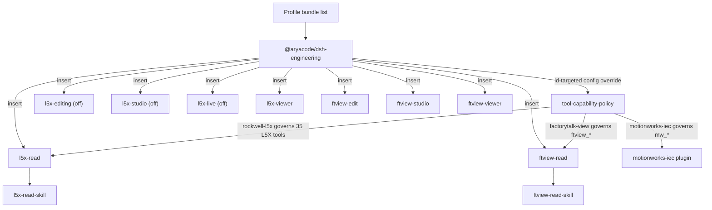

# dsh-engineering

One built-in engineering bundle for AryaAI. It puts the Studio 5000 L5X and FactoryTalk View ME
products behind a single install surface, one row per capability, and one switch per product. The
switch governs the tools and the guidance together, so turning a product off removes its tool
schemas from the request instead of leaving them visible.

The bundle currently owns two products:

- **Studio 5000 L5X** — offline reading, references and checks, staged draft editing, Logix Designer
  SDK builds, supervised controller access, live EtherNet/IP reads, and a ladder viewer.
- **FactoryTalk View ME** — export reading, structural checks and comparison, staged display and HMI
  tag editing, a manual Studio handoff, and a display preview.

FactoryTalk Optix and CAD mount as independent plugins outside this repository. MotionWorks IEC is
migrating into the bundle; until that flip, its standalone plugin mounts alongside it. The policy
links `optix_*` and `mw_*` to their skills so the same switch model applies.

## Components

Each row is a stable component id. Profiles and patches address these ids, so per-row enable state
survives upgrades even when the implementation behind a row changes.

| Row id | Package entry | Default | Contributes |
|---|---|---|---|
| `l5x-read` | `dsh-engineering-l5x` | on | Eleven offline tools: open, overview, list, read, search, references, trace, resolve, usage, checks, compare |
| `l5x-read-skill` | `dsh-engineering-l5x/skill` | on | The `rockwell-l5x` guidance shown to the model |
| `l5x-editing` | `dsh-engineering-l5x/editing` | off | Nine `draft_*` tools that stage edits and write one new L5X |
| `l5x-studio` | `dsh-engineering-l5x/studio` | off | Six Logix Designer SDK tools (status, capabilities, export, verify, build, evidence) and seven supervised controller tools |
| `l5x-live` | `dsh-engineering-l5x/live` | off | Direct EtherNet/IP reads and the bounded PLC trend |
| `l5x-viewer` | `dsh-engineering-l5x-viewer` | on | The ladder viewer client face |
| `ftview-read` | `dsh-engineering-ftview` | on | Six read tools for a FactoryTalk View ME export |
| `ftview-read-skill` | `dsh-engineering-ftview/skill` | on | The `factorytalk-view` guidance |
| `ftview-edit` | `dsh-engineering-ftview/edit` | on | Five tools that stage display and tag edits and apply them to a new folder |
| `ftview-studio` | `dsh-engineering-ftview/studio` | on | Studio discovery, changed-file preflight and the manual import plan |
| `ftview-viewer` | `dsh-engineering-ftview-viewer` | on | The ME display preview client face |
| `mwi-session` | `dsh-engineering-mwi` | on | Seven session tools: find, stage, open, start, inspect, worksheet and close |
| `mwi-read` | `dsh-engineering-mwi/read` | on | Seven saved-project read tools: overview, list, get, search, references, review and help |
| `mwi-read-skill` | `dsh-engineering-mwi/skill` | on | The `motionworks-iec` guidance |
| `mwi-verify` | `dsh-engineering-mwi/verify` | on | Three tools: compile, diagnostics and saved-source baselines |
| `mwi-edit` | `dsh-engineering-mwi/edit` | off | Seven tools: code, declarations, structure, block insertion, POU packages, validation and apply |
| `optix` | `@aryacode/dsh-tool-ft-optix` | on | FactoryTalk Optix Studio discovery, live authoring, preview and OCR |

The heavy surfaces are separate rows on purpose: a read-only profile pays for the read tools and
nothing else. The viewers are independent of the tools, so switching L5X tools off does not remove
the ladder viewer.

## Install

The bundle ships with AryaAI. The installer pins the packed bundle
(`apps/desktop/bundled-plugins/dsh-engineering-<version>.tgz`) and installs it into the application's
`dsh` payload; a profile lists `dsh-engineering` in its bundle list.

- In the application, the bundle appears as the **Engineering** card on the Plugins page, and each
  row above is listed under it as a component.
- In a development checkout, link this repository into the profile bundle list and run the app; the
  development home mounts the same rows.
- Updates ship with the installer. Disabling a row keeps its enable state in the profile, so the
  next update does not silently turn it back on.

## How it composes

The bundle adds one loader layer after the Web app. It patches the existing `tool-capability-policy`
row and inserts its own rows; it does not replace a product plugin id.

The policy keeps `onDemand: false`, so the bundle does not change the product-wide eager tool
exposure. Context is saved by the switches and by splitting the surfaces into separate rows.

## What the policy changes

Turning a skill off removes its tool schemas and its guidance from the next request. Turning it back
on restores both.

| Skill | Tools it governs | What switching it off hides |
|---|---|---|
| `rockwell-l5x` | `l5x_*` and the 35 L5X tools listed in the [reference](docs/reference/tools.md#l5x) | L5X tools and the L5X guidance |
| `factorytalk-view` | `ftview_*` | FactoryTalk View tools and guidance |
| `motionworks-iec` | `mw_*` | Guidance and tools for the independent MotionWorks plugin |
| — | `optix_*` | Nothing: Optix has no skill yet, so its tools stay visible |

The patch still links `l5x_` for future prefixed tools; the rebuilt L5X tools use descriptive names
(`open_project`, `draft_apply`, …), so the capability also lists them by exact name. The reference is
generated from the registered definitions, and `pnpm test` fails if a tool is not governed.

## Tools

49 tools across the two products. The [tool reference](docs/reference/tools.md) documents every name,
description and parameter, generated from the same definitions the plugins register.

| Product | Groups | Tools |
|---|---|---|
| L5X | read, references, checks, drafts, Studio SDK, controller, live | 35 |
| FactoryTalk View | read, edit, Studio | 14 |

Start with [Examples](docs/examples.md) for an end-to-end read, a staged edit and a FactoryTalk View
session.

## Requirements

| Surface | Needs |
|---|---|
| L5X read, references, checks, drafts | Node only; reads `.L5X` revision 19 or later |
| L5X Studio SDK | Studio 5000 with the Logix Designer SDK service, FactoryTalk Linx, .NET |
| L5X controller | Reachable controller, FactoryTalk Linx, a matching uploaded ACD |
| L5X live | A reachable controller over EtherNet/IP; no Studio, Linx or ACD |
| FactoryTalk View read, edit | Node only; a FactoryTalk View ME export folder |
| FactoryTalk View Studio | FactoryTalk View Studio ME installed for discovery and the manual import |

## Safety

- **Read-only by default.** Reading, checks, comparison and the viewers do not change a controller.
- **Edits write new files.** `draft_apply` writes one new L5X beside the source and refuses to
  overwrite; `ftview_apply` writes a new export folder and leaves the source untouched.
- **Controller changes need a human.** Upload, mode change and download require per-call approval
  and a session policy that permits asking. The tools refuse before contacting a controller when
  approval is unavailable, and downloads accept only a verification id produced by a passed build.
- **No hidden vendor execution.** FactoryTalk View Studio handoff returns a manual import plan; it
  does not run a vendor utility.
- **Coverage is stated.** Results name what the export cannot establish, including whether online
  logic matches the export and whether FBD/SFC semantics are exercised.

## Documentation

| Document | Owns |
|---|---|
| [Tool reference](docs/reference/tools.md) | Every tool, parameter and description (generated) |
| [Examples](docs/examples.md) | End-to-end sessions for both products |
| [Architecture](docs/architecture.md) | Composition, row model, configuration, client faces, packaging |
| [Port designs](docs/port/l5x.md) | The L5X port decisions and measurements |
| [FTView port design](docs/port/ftview.md) | The FactoryTalk View port decisions |
| [MotionWorks IEC port](docs/port/mwi.md) | The MWI migration design, phases and inventory |
| [Packaging](docs/port/packaging.md) | How the bundle is packed and pinned |
| [Retirement](docs/port/retirement.md) | What "gone" means for a retired plugin |
| [Changelog](CHANGELOG.md) | Released and unreleased changes |

## Known gaps

- MotionWorks IEC is migrating into this bundle; the standalone plugin still mounts until the port
  flips. The design and phase order are in [the port plan](docs/port/mwi.md).
- FactoryTalk Optix and CAD are not ported into this repository. Their plugins mount independently,
  and Optix has no skill to link yet.
- FactoryTalk View Studio work is a manual handoff: the bundle plans the import and checks changed
  files but does not import them.
- Live reads and SDK builds cannot establish that online logic matches the export; every result says
  so in `coverage`.
