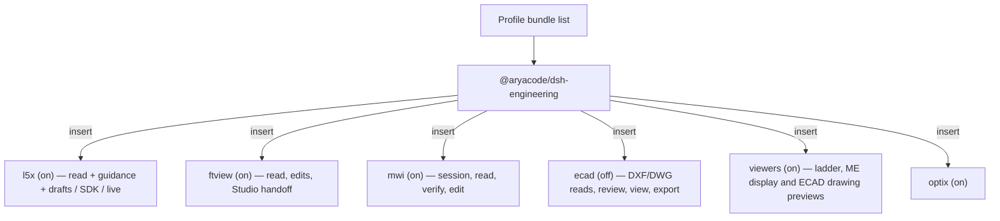

# AryaCode Engineering

**One bundle for automation-engineering work in AryaCode.** Studio 5000 L5X, FactoryTalk View ME,
MotionWorks IEC, FactoryTalk Optix and ECAD electrical prints sit behind a single install, one row per
surface. A row is the switch: disable it and that plugin unloads, so its tool schemas leave the request.

`@aryacode/dsh-engineering` · 172 tools · 10 rows · 6 products · MIT

**New here? Start with [Getting started](docs/getting-started.md)** — what each row needs, the loop every
product follows, and the first prompt to paste per product.

## Harness compatibility

Verified on AryaCode **0.2.2-alpha.2** (build `0.2.2-alpha.2.AryaCode.0.1.0`) on
2026-10-28: 0.22.2 installed from npm into a clean packaged profile, loaded with
no import or activation error, and the market reported the bundle `live` with
`diagnostics.findings` empty. The 0.20.x line is what the 0.2.1-rc.3 builds
shipped and is still published, so either host version can install a matching
release.

The package declares no `dsh.engines.dsh` range today, so the market cannot state a requirement for
it: with a readable manifest the card says "Host requirement undeclared", and when the manifest
lookup fails it says "Host requirement unknown". Declaring
`^0.2.2-alpha.2 || ^0.2.1-rc.3` is the next metadata change; it only takes effect in a release,
because the market reads the published manifest.

---

## Why a bundle

A general assistant pays for every tool schema on every request. An automation engineer needs deep
surfaces — reading a 3 MB L5X, comparing two projects, staging ladder edits, talking to a controller —
but only one or two of them at a time.

This bundle splits those surfaces into one row per product. The expensive surfaces are switches inside
the row. Every product except ECAD ships on by default so a fresh install can use it; ECAD is a new,
large surface and ships listed but off. Switch off what a read-only or low-context profile does not
need:

| Product row | Config option | Default | What turning it on adds |
|---|---|---|---|
| `l5x` | `editing` | on | the 17 staged-draft schemas |
| `l5x` | `studio` | on | the optional Logix Designer SDK and supervised controller schemas |
| `l5x` | `live` | on | the EtherNet/IP read, batch, discovery, clock and trend schemas |
| `l5x` | `allowWrites` | on | the two approval-gated writes (tag, wall clock) |
| `ftview` | `edit`, `studio` | on | staged ME edits and the Studio handoff |
| `mwi` | `edit` | on | the seven MotionWorks edit schemas |
| `optix` | `allowWrites`, `allowDestructive`, `allowInvoke`, `preview`, `ocrExecutable` | on | Studio authoring, destructive ops, method invocation, emulator preview and OCR when Tesseract is set |
| `ecad` | `writes`, `bridgeServerName` | off | deliverable writes only — a document export or a backup copy, each naming its own new path (the row itself also ships off); drawing authoring runs in AryaCAD Electrical |

The default-on surface is a budgeted quantity: `components.json` records the tools and the characters
of model-visible schema a fresh install may mount, and a component that would exceed either ceiling
ships switched off until the ceiling is raised with its measurement. The
[component contract](docs/reference/components.md#context-budget) owns the budget.

The previews are independent of the tools — switching a product off does not remove any of the three
viewers (ladder, ME display, ECAD drawing). All three mount from **one** row (`viewers`), because a
package registers exactly one browser bundle.

## What it supports

| Product | Tools | Default | Needs |
|---|---|---|---|
| **Studio 5000 L5X** | 54 | all on | Node for reads and edits; an optional Logix Designer SDK for SDK builds; a controller for live |
| **FactoryTalk View ME** | 51 | all on | Node for an export folder; FactoryTalk View Studio ME for discovery and the handoff |
| **MotionWorks IEC** | 24 | all on | MotionWorks IEC 3 Pro installed; verified against 1.19 |
| **FactoryTalk Optix** | 14 (3 need preview) | all on | Optix Studio installed; Tesseract for OCR |
| **ECAD electrical prints** | 12 | off | none; reads DXF prints (DWG through the embedded converter, no external app); authoring is optional and runs in AryaCAD Electrical through its own MCP row |
| **Engineering resources** | 2 | all on | none; a profile needs an L5X or FactoryTalk View project open |
| **SLC 500 and PLC-5 to Logix migration** | 7 | all on | none; reads an RSLogix 500 .RSS/.ACH or RSLogix 5 .RSP project hidden when that product is installed, otherwise the .SLC export, plus the .L5K a migration wizard writes |
| **RSLogix 5 (PLC-5) program reads** | 8 | off | RSLogix 5 installed for the automation-server reads (the container reader answers from the file alone without it); Node for the container census |

Tool groups, by product:

- **L5X** — 13 read (`open_project` … `document_project`), 17 staged edits (`draft_*`, `compose_rung`, `compose_batch`), 6 Logix
  Designer SDK, 7 supervised controller, 7 live EtherNet/IP (2 reads, 2 identity/discovery, 1 batch read, 2 approval-gated writes), 3 preview and 1 diagram
- **L5X chat composition** — `l5x_compose_logic` needs no project and writes no file: named
  patterns or raw NeutralText go in, `paste_text` plus the tag declarations come out, ready to paste
  into a Studio 5000 ladder routine. Parallel branches use `[path1,path2]`; the ladder syntax and
  instruction mnemonics are validated, while tag existence/types and Studio compilation are
  reported as unverified.
- **FactoryTalk View** — 22 read (including `ftview_document`), 22 staged edits, 3 Studio handoff
- **MotionWorks IEC** — 7 session, 7 saved-project reads, 3 verify, 7 direct edits
- **Optix** — 14 tools, linked to the `factorytalk-optix` guidance; `optix_netlogic` reads the pinned NetLogic cheat-sheet snapshot, `optix_library` lists and imports the template libraries the Studio install ships, and the bridge tools need Studio
- **Migration** — 7 tools and the `legacy-to-logix-migration` skill: `slc_read` opens an .RSS/.ACH (RSLogix 500) or .RSP (RSLogix 5) hidden through its 32-bit automation server and returns program files, rung text, symbols and data files without a window; `migration_assess` reads an .SLC, .RSS/.ACH/.RSP or .L5K file and states what it is; `l5k_lint` reports the import blockers in the .L5K with line numbers; `migration_compare` scores an .RSS against the converted .L5X by routine, rung, symbol and data file; `migration_resolve` turns every PCE marker and unknown `?` operand the wizard left into a proposed Logix answer, marked answerable or needing review; `migration_report` writes the report a person signs off from — a formatted Word document or Markdown carrying the pre- and post-correction census, the corrections rung by rung and the open items that need their decision; `migration_plan` keeps the intake decisions, stage evidence and exceptions in .migration/plan.json
- **PLC-5** — 8 read-only tools and the `rslogix-5` skill: `plc5_capabilities` reports the 32-bit host, the registered RSLogix 5 automation server and the container census (streams, sizes, packed flags); `plc5_open` opens an .RSP hidden through `RSLogix5.Application` with the do-not-save flag and returns the program-file census (52 files / 2,168 rungs on the reference project), falling back to the container reader — which names the project, the processor and the ladder program files from the file alone — when RSLogix 5 is absent or will not start; `plc5_ladder` pages rung text in neutral mnemonic form; `plc5_find` searches every rung and the symbol table; `plc5_io_census` reduces the program's `I:`/`O:` references to rack/slot cells and splits configured racks from program-only racks; `plc5_io_config` lists the configured chassis with adapter part numbers and rack/group ranges; `plc5_data_read` returns the data-file table (data-file values are not stored readably and are never claimed); `plc5_processor` names the controller — type string, author, memory, type code, series, driver and RSWho route, each labelled with its source. The point cards are not in the project and no tool invents them
- **Engineering resources** — 2 tools and the `engineering-standards` skill: `engineering_reference` reads the
  local 41-page corpus (IEC 61131-3, Rockwell, SLC/PLC-5 migration, Yaskawa, HMI, Optix, craft) and `engineering_profile` infers the
  open project's own naming, idioms and HMI palette, with evidence and a confidence level
- **ECAD** — 10 read (`ecad_capabilities` … `ecad_compare`) and 2 deliverables (`ecad_document`,
  `ecad_backup`), plus the `ecad-review` skill: the engine parses DXF (and DWG through the embedded
  converter), infers the print set's profile from the title blocks and ACADE `WD_M`, reads title blocks, an index sheet,
  cross-reference candidates and checks, renders layouts as SVG, and compares a drawing against a kept copy.
  Authoring is not this row's: it runs in AryaCAD Electrical, whose MCP bridge `ecad_capabilities` reports as mounted
  or not ([the bridge](docs/aryacad-bridge.md))

## Switches

A row is a plugin. Disabling it in the profile (or on the Plugins page) unmounts that product and its
tool schemas stop being sent. Each product's optional surfaces are config on the same row, so the
cheap decision — is this product on at all — takes one switch, and the fine decision lives one level
down:

| Row | Mounts | Config options (default) |
|---|---|---|
| `l5x` | offline reads, checks, comparison and the `rockwell-l5x` guidance; optionally drafts, SDK, live (reads, batch, discovery, clock) and supervised writes | `editing` (on), `studio` (on), `live` (on), `allowWrites` (on) |
| `ftview` | FactoryTalk View ME read, guidance and edits; optionally the Studio handoff | `edit` (on), `studio` (on) |
| `mwi` | MotionWorks IEC session, reads, verify, guidance and the edits | `workspace` (empty), `edit` (on) |
| `ecad` | ECAD drawing reads, review, cross-reference, checks, render/compare and the review/backup deliverables, with the `ecad-review` skill; the row ships off, `writes` covers deliverables only, and `bridgeServerName` names the AryaCAD MCP server it reports on | `writes` (off), `bridgeServerName` (`ocs`), `maxFiles` (2000), `maxFileBytes` (64 MiB), `maxEntities` (200000) |
| `viewers` | ladder, ME display and ECAD drawing previews | — |
| `engineering-preset` | none — the preset's own settings, read from the row | on | nothing; registers through the host's `agentPresets` service and tolerates a composition without one |
| `engineering-resources` | the engineering corpus, the house-style profile and the `engineering-standards` skill; no project of its own | `reference` (on) |
| `migration` | legacy SLC 500 / PLC-5 assessment, the .L5K linter, the conversion-marker resolver and the signed migration report, with the `legacy-to-logix-migration` skill | `assess` (on), `lint` (on), `compare` (on), `resolve` (on), `report` (on), `plan` (on) |
| `plc5` | RSLogix 5 (PLC-5) `.RSP` reads — capabilities, project census, ladder, search, I/O footprint, chassis configuration, data-file table, processor identity, with the `rslogix-5` skill; the row ships off and writes nothing | `capabilities` (on), `open` (on), `ladder` (on), `find` (on), `ioCensus` (on), `ioConfig` (on), `dataRead` (on), `processor` (on) |
| `optix` | FactoryTalk Optix Studio authoring and the NetLogic reader | `bridgeUrls` (8768), `bridgeToken` (empty), `allowWrites` (on), `allowDestructive` (on), `allowInvoke` (on), `preview` (on), `allowPreviewInput` (on), `browser` (`launch`), `browserChannel` (`auto`), `browserPath` (empty), `browserHeadless` (off), `cdpUrl`, `previewUrl`, `ocrExecutable` (empty), `ocrLanguage` (`eng`), `ocrTessdataDirectory` (empty), `netlogic` (on) |

A row can also be inserted `disabled` when a component ships off by default: the row is still listed,
and one switch enables it. ECAD and RSLogix 5 (PLC-5) are the two rows in this release that ship off;
every other row ships on.

**Why the row list collapsed.** The Plugins page lists a bundle's rows flat and skips `cordis:group`
containers (`plugin-manager/src/index.ts`: *"Group rows are containers … their children carry the
switches"*), so a group switch is a shell feature, not a bundle one. Five product rows and three support rows with config is
what a bundle can do on its own — no harness change to carry across DSH upgrades.

**No capability policy.** Earlier releases also carried a per-skill tool filter (`policyOnly` /
`toolPolicy`) that gated tools by skill state. That filter is an AryaAI harness feature and is **not
part of this product line** — `@deepseek-ai/dsh-tool-skill` here has no such config. Rows are the
switch. Do not re-add a patch entry that targets another bundle's row: composition fails when the row
is absent, and that is what made 0.4.0 and 0.4.1 uninstallable.

The reference in [docs/reference/tools.md](docs/reference/tools.md) is generated from the registered
definitions, and `pnpm test` fails when the committed reference drifts.

## Status

Where each surface actually stands, based on what has been exercised.

**Working and verified**

- L5X offline reads, references, usage, checks and comparison against revision 19+ projects
- Staged L5X editing — fifteen `draft_*` tools, the instruction catalog, `compose_rung`, validation and one new file on apply
- Logix Designer SDK: a real ACD exported to a 3.0 MB L5X against SDK v37
- Supervised controller access — upload, mode change and download behind per-call approval, with
  downloads accepting only a verification id produced by a passed build
- Live EtherNet/IP: polling, one-request batch reads of up to 64 tags, controller identity and clock, LAN discovery, and a bounded trend
- Supervised live writes: `write_live_tag` and `write_controller_clock` need the row's `allowWrites` switch **and** per-call human approval, and report the value the controller reads back
- FactoryTalk View ME: export reads, structural checks, comparison, display and tag edits, display and
  object authoring, vendor-schema validation, the vendor export path and object-level import
  verification; commissioned on a real Studio export (18 displays, 361 tags, no parse errors) and a
  real application export (13 displays, 19 files, 74 applications listed)
- MotionWorks IEC: verified live against 3 Pro 1.19 — direct open with a verified pre-edit backup
  under `.motionworks/attached`, attach-without-reload to a project the IDE already has open, start,
  worksheet, close, saved-project reads, compile diagnostics, code replacement, declaration add, POU
  create/delete, block insertion and a POU package export/delete/import round trip
- Ladder viewer and FactoryTalk View display preview
- ECAD electrical prints: the engine parses all 34 sheets of a real print set into 83,936 primitives with
  zero unsupported and zero truncated layouts, reads title blocks, the 80-row index sheet, a 0.95-confidence
  profile from the ACADE `WD_M` attributes, 74 cross-reference candidates and 97 findings; all 34 sheets
  write → re-read → rebuild with zero model difference, and the twelve tools are exercised through a fake
  Host composition (sandbox-policy writes, source untouched, explicit failure envelopes). The right-panel
  viewer and the DWG converter landed in the same batch.
- ECAD DWG: the embedded acadrust 0.6.8 converter (WASM, 6.4 MB) converted **33/33** real DWGs in
  **1.17 s** total with zero reader warnings, preserving each drawing's version (16 AC1027, 17 AC1032);
  DXF→DWG→DXF and DWG→DXF→DWG→DXF round trips were **0/0/0** on the measured sheets (one sheet showed
  only an anonymous-block rename), and the panel service opened a real DWG (title block `004`) with its
  conversion provenance, leaving the source untouched. The DWG and DXF sets are different title-block
  issues, so equivalence is reported as measured (~90 % shared geometry) rather than as equality.
- ECAD drawing preview: the committed face artifact was rendered in headless Chrome against a real corpus
  sheet — fit, pan, zoom, selection, layer hide, light and dark, zh and en, narrow panes, and the error,
  empty, truncated and DWG states — with zero console errors. The Dev AryaCode pass then opened a real
  DWG in the app's right panel: DWG badge, 213 entities, layer list, title-block fields and conversion
  provenance, with no client error.
- ECAD drawing preview: the committed face artifact was rendered in headless Chrome against a real corpus
  sheet — fit, pan, zoom, layer hide, text search, light and dark, zh and en, narrow panes, and the error,
  empty, truncated and DWG states — with zero console errors. The Dev AryaCode pass then opened a real
  DWG in the app's right panel: DWG badge, 213 entities, layer list, title-block fields and conversion
  provenance, with no client error.
- ECAD CAD workspace: **retired in 0.93.0.** The pane was a CAD-style editor — marquee window/crossing
  selection, grips with live setter previews, endpoint/midpoint/centre/nearest/intersection/grid osnaps,
  a staged tool palette (line, polyline, rectangle, circle, arc, revision cloud, leader, text, block insert;
  move, copy, rotate, scale, mirror, offset, trim, extend, erase), properties and layer editing, and apply
  to a **new verified file** — measured through 38 client tests and a 24-shot headless interaction harness.
  Maintaining a second CAD editor was not worth the upkeep: AryaCAD Electrical is the authoring surface, and
  the pane is now a read-only viewer — drag to pan, wheel zoom, `+`/`−`/`0` and the arrow keys, layer
  hide/show with entity counts, text search with on-sheet highlight, print, and SVG/PNG export. The
  committed face is 159,804 bytes where the editor was 412,825, and its stylesheet carries only the classes
  the viewer reads.
- ECAD conversation intelligence: every `ecad_*` tool renders as a themed card instead of the generic
  row — open (DXF/DWG badge, conversion warnings, coverage, title block), scan, checks (severity counts
  and findings), cross-reference (candidate confidence), render (layout and SVG path) and capabilities
  (engine, limits, contract and whether the AryaCAD bridge is mounted) are specialised,
  the rest use labelled field cards; errors print code/message/fix and malformed payloads never invent
  counts. The panel carries its own sheet and layer status; there is no separate composer
  status bar above the message input.

**On by default** — every tool surface except ECAD mounts on a fresh install; ECAD is listed and off
until enabled, and its writes are off even then. Switch one off from the row's Configure page in Plugins
(`l5x` editing/Studio/live/allowWrites, `mwi` edit, `optix` authoring/preview, `ecad` writes)
when the profile is read-only or the request budget is tight. Tool schemas are sent on every request, so
the lean profile is the one that turns them off.

**Known limits** — stated in the bundle, not hidden:

- Live reads, SDK builds and live writes cannot establish that online logic matches the export; every result says
  so in `coverage`
- FBD/SFC semantics are not exercised
- FactoryTalk View **import and runtime creation are Studio steps**: the bundle exports through the
  vendor engine, authors and schema-validates the displays, writes the `BatchImport` manifest, and
  verifies the import object by object afterwards; it does not import or build a `.mer`
- The vendor export does not include the HMI tag CSV, so tag bindings cannot be checked from a fresh
  export unless that database is exported separately
- Optix is linked to a skill now: the `factorytalk-optix` guidance plus the NetLogic reader; the bridge tools still follow the `optix` row config and the Studio bridge
- The generated tool reference covers the 158 tools built from this repository (138 default-on plus 12 ECAD and 8 RSLogix 5 tools that ship off); the 13 vendored Optix tools are not generated from source here, so their descriptions live only in their own definitions and in the README, and `optix_netlogic` is counted with them rather than inside the 158 because the generator reads the packages' sources, not `entries/`. The context budget's character ceiling covers the 138 default-on generated definitions only — the tool-count ceiling covers every default-on tool including Optix
- ECAD support is measured, not assumed: cross-reference rows are candidates with a confidence, unsupported entities are reported per sheet, and geometry beyond the planar drawing assumption (OCS/extrusion normals, thickness, non-uniform block scaling) is reported as approximate. DWG conversion is measured on the print set: every one of the 33 DWGs was opened and converted with its version preserved (33/33), with four sheets reporting linetype-metadata normalisation only. The drawing pane is a read-only viewer: pan, zoom, fit, layer visibility, text search with highlight, print through the browser print dialog, and PNG export that rasterises the SVG through a browser canvas; the CAD editing surface it replaced was measured in its own release and is recorded where it was retired. The DWG converter now uses a fresh wasm instance per conversion with one transient-trap retry, and the test command runs one spec file per child process, because a reused allocator could abort after a long session. Proxy objects, ACIS bodies and xrefs remain unmeasured and are reported through the converter's diagnostics; DWG→DXF output is about 5× the shipped DXF because the shipped set is an exploded, block-purged export. No drawing is called a faithful round-trip without that evidence

**Not in this repository** — mechanical CAD mounts (SolidWorks, Inventor) remain an independent plugin;
electrical drawings (DXF, and DWG through the embedded converter) are in this bundle.

## Milestones

| Version | What landed |
|---|---|
| **0.8.0** | FactoryTalk View authoring: export through the vendor engine, author displays and objects in a schema-validated tree, stage a `BatchImport` handoff, and verify the import object by object |
| **0.7.0** | Ladder generation that cannot emit invalid NeutralText: an instruction catalog, a pattern/tree composer that resolves and type-checks every operand, rung comments read and written, and a documentation bundle (`document_project`) with the Studio tags-and-comments CSV |
| **0.5.0** | Commissioned on real files: FactoryTalk View reads genuine Studio exports (`<gfx>` displays, comma CSVs, UTF-16) instead of reporting zero; L5X alias resolution cuts 315 false "unresolved reference" findings to 16 on a 1279-tag project; `add_tag` no longer demands a value; a locked ACD exports from a copy |
| **0.4.17** | MotionWorks edits the real project again: the pre-edit backup is written where the bridge and engine verify it, an already-open project is attached instead of reloaded, and `mw_get` returns the body hash the edit takes |
| **0.4.15** | Every tool surface ships on by default; the row Configure pages switch them off |
| **0.4.4** | One row per product: five rows, optional surfaces moved into each row's config |
| **0.4.0** | Both previews fold into the bundle's own client face — one package, one browser bundle, 16 rows |
| **0.4.6** | Full EtherNet/IP surface: batch reads, discovery, controller clock, and approval-gated tag and clock writes; 84 tools |
| **0.3.0** | FactoryTalk Optix becomes a bundle component; 79 tools total |
| **0.2.0** | MotionWorks IEC ports into the bundle — 24 tools over the COM bridge and saved-model engine, verified live; edit off by default |
| **0.1.2** | Harness filesystem contract fixed across L5X and FactoryTalk View; every L5X tool linked to its capability by name; generated tool reference, examples and architecture docs |

## Install

Install **Engineering** from the market (**Plugins → Arya Plugin Market → Engineering** → Install or
Update), then open a chat. The bundle carries its components (`vendor/`), its own browser face (both
previews) and the rows; installing a component on its own gives you tools **without** the rows that
switch them.

Manual install, for a profile managed by hand:

```sh
# in the AryaCode profile
pnpm add @aryacode/dsh-engineering
```

```jsonc
// profile package.json
"dsh": { "profile": { "bundles": ["@aryacode/dsh-engineering"] } }
```

Then, in the application, the **Engineering** card lists each row as a component. Per-row enable state
lives in the profile, so disabling a row survives the next update.

First session after install: open the workspace folder that holds your export or project, then ask in
plain language — "open Line.L5X and run the checks", "list the FactoryTalk View ME applications", "find
the MotionWorks projects here". The agent picks the product's skill and tools; [Getting
started](docs/getting-started.md) has the exact prompts and the boundaries.

For development, clone this repository, `pnpm install`, and link it into a profile bundle list; the
development home mounts the same rows.

## How it composes

The bundle adds one loader layer after the Web app: it **inserts** its own rows and never touches a row
another bundle owns.



Row ids are stable. Profiles and patches address these ids, so per-row enable state survives upgrades
even when the implementation behind a row is replaced.

| Row id | Package entry | Config options |
|---|---|---|
| `l5x` | `dsh-engineering-l5x` | `editing` on · `studio` on · `live` on · `allowWrites` on |
| `ftview` | `dsh-engineering-ftview` | `edit` on · `studio` on |
| `mwi` | `dsh-engineering-mwi` | `edit` on |
| `ecad` | `@aryacode/dsh-engineering/ecad` (twelve drawing tools + the `ecad-review` skill) | `writes` off · `bridgeServerName` `ocs` · `maxFiles` 2000 · `maxFileBytes` 64 MiB · `maxEntities` 200000 |
| `viewers` | `@aryacode/dsh-engineering` (its own client face: ladder, ME display and ECAD drawing previews) | — |
| `optix` | `@aryacode/dsh-engineering/optix` (wraps the prebuilt `@aryacode/dsh-tool-ft-optix`) | `allowWrites` on · `allowDestructive` on · `allowInvoke` on · `preview` on · `netlogic` on |

## Safety

- **Read-only by default.** Reading, checks, comparison and the viewers never change a controller.
- **Edits write new files.** `draft_apply` writes one new L5X beside the source and refuses to
  overwrite; `ftview_apply` writes a new export folder and leaves the source untouched. MotionWorks
  edits write the real workspace project, after one complete backup under
  `<workspace>/backups/motionworks/`, and verify unrelated saved and native state.
- **Drawing deliverables write new files.** `ecad_document` and `ecad_backup` write a review bundle or a
  copy into a new path and refuse to overwrite; the row's `writes` switch must be on first, review never
  writes, and a read-only session refuses. The pane never edits a drawing: authoring runs in AryaCAD
  Electrical, and this row's gate is that a bridge-made change is only accepted once `ecad_compare`
  against a kept copy names what moved. Binary deliverables are published through a policy-checked writer
  because the host filesystem service is text-only: the destination must stay inside the writable
  workspace, and the create guard is kept.
- **One backup tree.** Every product backs up into
  `<workspace>/backups/<product>/<subject>/<UTC stamp>/` with a `backup-manifest.json` naming each
  copied file and its SHA-256, so "back up this project" means the same place in every skill.
  MotionWorks takes its backup on open; L5X, FactoryTalk View and Optix take one on request and before
  an in-place change. `<workspace>/_backups` and `<workspace>/backups/<project>/…` are older layouts
  and are never written.
- **Controller changes need a human.** Upload, mode change and download require per-call approval and
  a session policy that permits asking. The tools refuse before contacting a controller when approval
  is unavailable, and a download accepts only a verification id produced by a passed build.
- **Live writes take two keys.** `write_live_tag` and `write_controller_clock` need the row's
  `allowWrites` switch *and* approval for that exact write; the tag is validated against the export
  first and the result is the value the controller reads back (`WRITE_NOT_VERIFIED` if it differs).
- **No hidden vendor execution.** The FactoryTalk View Studio handoff returns a manual import plan; it
  does not run a vendor utility.
- **Coverage is stated.** Every result names what it cannot establish, including whether online logic
  matches the export.

## Requirements

| Surface | Needs |
|---|---|
| L5X read, references, checks, drafts | Node only; reads `.L5X` revision 19 or later |
| L5X Studio SDK (optional) | Studio 5000 with the Logix Designer SDK service, FactoryTalk Linx, .NET. An optional extra: reads, drafts and the written L5X need none of it, and the engineer imports the new file into Studio themselves |
| L5X controller | Reachable controller, FactoryTalk Linx, a matching uploaded ACD |
| L5X live | A reachable controller over EtherNet/IP; no Studio, Linx or ACD |
| FactoryTalk View read, edit, author | Node only; a FactoryTalk View ME export folder, plus an installed `Gfx-ME*.xsd` for schema validation |
| FactoryTalk View export | FactoryTalk View ME Studio installed on the host (the export server runs without an open window) |
| FactoryTalk View Studio | FactoryTalk View Studio ME for discovery and the manual import |
| MotionWorks IEC | MotionWorks IEC 3 Pro; the 32-bit COM bridge and the Python saved-model engine |
| ECAD read, review, view, export | Node only; DXF drawings (DWG through the embedded converter, no external app); the row must be enabled, and its `writes` switch only for the document/backup deliverables. Authoring needs AryaCAD Electrical mounted as an MCP row by the owner — the bundle never installs or starts it |
| Optix | FactoryTalk Optix Studio |

## Documentation

| Document | Owns |
|---|---|
| [Documentation map](docs/index.md) | Every page by task and by surface, with the figures and the records in one place |
| [Getting started](docs/getting-started.md) | The first session: what each row needs, the shared loop, and a paste-ready prompt per product |
| [Capabilities, shown](docs/capabilities.md) | Figures per surface, the exact call behind each one, and what a picture cannot prove |
| [Arya Automation Engineer](docs/preset-arya-automation.md) | The agent preset this bundle ships: the five-step contract, the engineering-tuned compaction, the ledger, and what a preset cannot make true |
| [Engineering resources](docs/resources.md) | The 41-page standards corpus, its rule IDs, the generated index, and the house-style profile |
| [SLC 500 and PLC-5 to Logix migration](docs/reference/migration.md) | The legacy assessment, the .L5K lint rules, the workflow and its limits |
| [RSLogix 5 (PLC-5) reads](docs/reference/plc5.md) | The eight read-only tools, the two read paths, the three inventories and the known gaps |
| [Workflow handbook (PDF)](docs/handbook/Engineering-Handbook.pdf) | The whole surface as a printable handbook with the four workflow diagrams; [editable DOCX](docs/handbook/Engineering-Handbook.docx) and [HTML](docs/handbook/Engineering-Handbook.html) beside it |
| [Tool reference](docs/reference/tools.md) | Every tool, parameter and description (generated) |
| [Components](docs/reference/components.md) | What a component is, the capability classes, the manifest fields, and the checklist for adding one |
| [Examples](docs/examples.md) | End-to-end sessions per product |
| [Any FTView application](docs/reference/ftview-any-app.md) | What is generic, what varies per application, and the import/verify loop |
| [Cross-referencing HMI against PLC](docs/reference/ftview-cross.md) | Join an export's tags to a Studio 5000 L5X: device addresses, display usage, logic usage, one-sided tags |
| [Optix NetLogic](docs/optix-netlogic.md) | The pinned NetLogic cheat-sheet snapshot: what it covers, its risk flags, and how one page is read |
| [Standards checks](docs/reference/standards-checks.md) | Every PLC and HMI rule a review reports, its severity, the corpus rule behind it and what a clean result does not prove |
| [Architecture](docs/architecture.md) | Composition, row model, configuration, client faces, packaging |
| [L5X port](docs/port/l5x.md) | L5X port decisions and measurements |
| [ECAD port](docs/port/ecad.md) | ECAD engine measurements, the DWG converter decision and the Typert panel service |
| [AryaCAD Electrical bridge](docs/aryacad-bridge.md) | Where reading ends and authoring begins: the overlay that mounts the CAD MCP row, what `ecad_capabilities` reports, and the backup → edit → save_verified → compare sequence |
| [FTView port](docs/port/ftview.md) | FactoryTalk View port decisions |
| [MotionWorks IEC port](docs/port/mwi.md) | MWI migration design, phases and inventory |
| [Packaging](docs/port/packaging.md) | How the bundle is packed and pinned |
| [Retirement](docs/port/retirement.md) | What "gone" means for a retired plugin |
| [Changelog](CHANGELOG.md) | Released and unreleased changes |

## Development

```sh
pnpm install
pnpm build:client  # build both client faces from source, then lib/client.js
pnpm test          # patch, docs, tool-reference, manifest and client-face checks
pnpm e2e:ladder    # render the built ladder face in headless Chrome and assert on the DOM
pnpm e2e:routines  # the same judgement for every routine of one export
pnpm e2e:actions   # click and key through the pane and assert it answers
pnpm e2e:instructions  # one rung per catalogued instruction, rendered and judged
pnpm docs:tools    # regenerate the tool reference from the registered definitions
pnpm docs:check    # fail if the committed reference has drifted
python scripts/gen-diagrams.py   # regenerate docs/diagrams/*.svg and *.png
python scripts/gen-handbook.py   # rebuild the PDF, DOCX and HTML handbook from those figures
```

The diagrams and the handbook are generated, not hand-drawn: layout lives in
`scripts/gen-diagrams.py` and the prose in `scripts/gen-handbook.py`, so a changed workflow is one edit
and one regeneration. Both need Pillow; the handbook also needs python-docx and reportlab.

Tests run through `tsx` so they can read the TypeScript tool factories. A registered tool that no
skill governs fails the suite — the policy is a test, not a convention.

## Licence

MIT. See [LICENSE](LICENSE).
