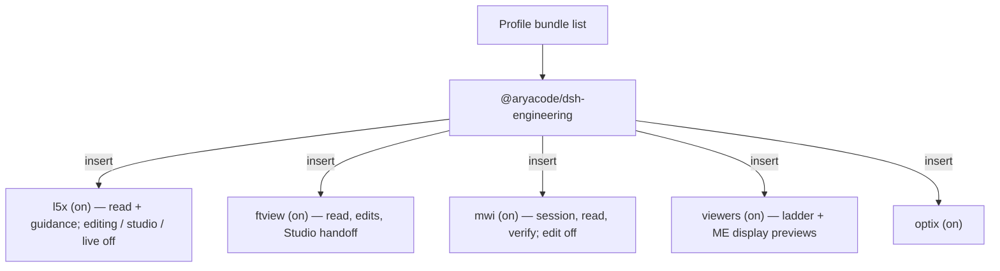

# AryaCode Engineering

**One bundle for automation-engineering work in AryaCode.** Studio 5000 L5X, FactoryTalk View ME,
MotionWorks IEC and FactoryTalk Optix sit behind a single install, one row per surface. A row is the
switch: disable it and that plugin unloads, so its tool schemas leave the request.

`@aryacode/dsh-engineering` · 84 tools · 5 rows · 4 products · MIT

---

## Why a bundle

A general assistant pays for every tool schema on every request. An automation engineer needs deep
surfaces — reading a 3 MB L5X, comparing two projects, staging ladder edits, talking to a controller —
but only one or two of them at a time.

This bundle splits those surfaces into one row per product. The expensive surfaces are a switch inside
the row, off by default, so a read-only profile pays for the read tools and nothing else:

| Product row | Config option | Default | What turning it on adds |
|---|---|---|---|
| `l5x` | `editing` | off | the nine `draft_*` schemas |
| `l5x` | `studio` | off | the Logix Designer SDK and supervised controller schemas |
| `l5x` | `live` | off | the EtherNet/IP read, batch, discovery, clock and trend schemas |
| `l5x` | `allowWrites` | off | the two approval-gated writes (tag, wall clock) |
| `ftview` | `edit`, `studio` | on | staged ME edits and the Studio handoff |
| `mwi` | `edit` | off | the seven MotionWorks edit schemas |

The previews are independent of the tools — switching a product off does not remove the ladder viewer.
Both previews mount from **one** row (`viewers`), because a package registers exactly one browser
bundle.

## What it supports

| Product | Tools | Default | Needs |
|---|---|---|---|
| **Studio 5000 L5X** | 40 | read on; edit, Studio, live **off** | Node for offline reads; Studio 5000 + Logix Designer SDK for SDK work; a controller for live |
| **FactoryTalk View ME** | 14 | all on | Node for an export folder; FactoryTalk View Studio ME for discovery and the handoff |
| **MotionWorks IEC** | 24 | session, read, verify on; edit **off** | MotionWorks IEC 3 Pro installed; verified against 1.19 |
| **FactoryTalk Optix** | 6 | on | Optix Studio installed |

Tool groups, by product:

- **L5X** — 11 read (`open_project` … `compare_projects`), 9 staged drafts (`draft_*`), 6 Logix
  Designer SDK, 7 supervised controller, 7 live EtherNet/IP (2 reads, 2 identity/discovery, 1 batch read, 2 approval-gated writes)
- **FactoryTalk View** — 6 read, 5 staged edits, 3 Studio handoff
- **MotionWorks IEC** — 7 session, 7 saved-project reads, 3 verify, 7 staged edits
- **Optix** — 6 tools, unlinked to a skill until one exists

## Switches

A row is a plugin. Disabling it in the profile (or on the Plugins page) unmounts that product and its
tool schemas stop being sent. Each product's optional surfaces are config on the same row, so the
cheap decision — is this product on at all — takes one switch, and the fine decision lives one level
down:

| Row | Mounts | Config options (default) |
|---|---|---|
| `l5x` | offline reads, checks, comparison and the `rockwell-l5x` guidance; optionally drafts, SDK, live (reads, batch, discovery, clock) and supervised writes | `editing` (off), `studio` (off), `live` (off), `allowWrites` (off) |
| `ftview` | FactoryTalk View ME read, guidance and edits; optionally the Studio handoff | `edit` (on), `studio` (on) |
| `mwi` | MotionWorks IEC session, reads, verify and guidance; optionally the edits | `edit` (off) |
| `viewers` | ladder + ME display previews | — |
| `optix` | FactoryTalk Optix Studio authoring | — |

**Why the row list collapsed.** The Plugins page lists a bundle's rows flat and skips `cordis:group`
containers (`plugin-manager/src/index.ts`: *"Group rows are containers … their children carry the
switches"*), so a group switch is a shell feature, not a bundle one. Five product rows with config is
what a bundle can do on its own — no harness change to carry across DSH upgrades.

**No capability policy.** Earlier releases also carried a per-skill tool filter (`policyOnly` /
`toolPolicy`) that gated tools by skill state. That filter is an AryaAI harness feature and is **not
part of this product line** — `@deepseek-ai/dsh-tool-skill` here has no such config. Rows are the
switch. Do not re-add a patch entry that targets another bundle's row: composition fails when the row
is absent, and that is what made 0.4.0 and 0.4.1 uninstallable.

The reference in [docs/reference/tools.md](docs/reference/tools.md) is generated from the registered
definitions, and `pnpm test` fails when the committed reference drifts.

## Status

Where each surface actually stands, based on what has been exercised.

**Working and verified**

- L5X offline reads, references, usage, checks and comparison against revision 19+ projects
- Staged L5X editing — nine `draft_*` tools, validation, and one new file on apply
- Logix Designer SDK: a real ACD exported to a 3.0 MB L5X against SDK v37
- Supervised controller access — upload, mode change and download behind per-call approval, with
  downloads accepting only a verification id produced by a passed build
- Live EtherNet/IP: polling, one-request batch reads of up to 64 tags, controller identity and clock, LAN discovery, and a bounded trend
- Supervised live writes: `write_live_tag` and `write_controller_clock` need the row's `allowWrites` switch **and** per-call human approval, and report the value the controller reads back
- FactoryTalk View ME: export reads, structural checks, comparison, staged display and HMI tag edits
- MotionWorks IEC: verified live against 3 Pro 1.19 — stage, start, worksheet, close, saved-project
  reads, compile diagnostics, code replacement, declaration add, POU create/delete, block insertion
  and a POU package export/delete/import round trip
- Ladder viewer and FactoryTalk View display preview

**Deliberately off by default** — enabled per profile: `l5x-editing`, `l5x-studio`, `l5x-live`, `allowWrites`,
`mwi-edit`. A read-only profile should not pay for nine draft schemas or a controller surface.

**Known limits** — stated in the bundle, not hidden:

- Live reads, SDK builds and live writes cannot establish that online logic matches the export; every result says
  so in `coverage`
- FBD/SFC semantics are not exercised
- FactoryTalk View Studio work is a **manual handoff**: the bundle plans the import and preflights
  changed files, it does not import
- Optix has no skill, so its 6 tools cannot be switched off

**Not in this repository** — CAD mounts as an independent plugin.

## Milestones

| Version | What landed |
|---|---|
| **0.4.4** | One row per product: five rows, optional surfaces moved into each row's config |
| **0.4.0** | Both previews fold into the bundle's own client face — one package, one browser bundle, 16 rows |
| **0.4.6** | Full EtherNet/IP surface: batch reads, discovery, controller clock, and approval-gated tag and clock writes; 84 tools |
| **0.3.0** | FactoryTalk Optix becomes a bundle component; 79 tools total |
| **0.2.0** | MotionWorks IEC ports into the bundle — 24 tools over the COM bridge and saved-model engine, verified live; edit off by default |
| **0.1.2** | Harness filesystem contract fixed across L5X and FactoryTalk View; every L5X tool linked to its capability by name; generated tool reference, examples and architecture docs |

## Install

The bundle carries its components (`vendor/`), its own browser face (both previews) and the rows.
Installing a component on its own gives you tools **without** the rows that switch them.

```sh
# in the AryaCode profile
pnpm add @aryacode/dsh-engineering
```

```jsonc
// profile package.json
"dsh": { "profile": { "bundles": ["@aryacode/dsh-engineering"] } }
```

Then, in the application, the **Engineering** card lists each row as a component. Per-row enable state
lives in the profile, so disabling a row survives the next update.

For development, clone this repository, `pnpm install`, and link it into a profile bundle list; the
development home mounts the same rows.

## How it composes

The bundle adds one loader layer after the Web app: it **inserts** its own rows and never touches a row
another bundle owns.



Row ids are stable. Profiles and patches address these ids, so per-row enable state survives upgrades
even when the implementation behind a row is replaced.

| Row id | Package entry | Config options |
|---|---|---|
| `l5x` | `dsh-engineering-l5x` | `editing` off · `studio` off · `live` off |
| `ftview` | `dsh-engineering-ftview` | `edit` on · `studio` on |
| `mwi` | `dsh-engineering-mwi` | `edit` off |
| `viewers` | `@aryacode/dsh-engineering` (its own client face: ladder + ME display previews) | — |
| `optix` | `@aryacode/dsh-tool-ft-optix` | — |

## Safety

- **Read-only by default.** Reading, checks, comparison and the viewers never change a controller.
- **Edits write new files.** `draft_apply` writes one new L5X beside the source and refuses to
  overwrite; `ftview_apply` writes a new export folder and leaves the source untouched. MotionWorks
  edits write only the staged copy and verify unrelated saved and native state.
- **Controller changes need a human.** Upload, mode change and download require per-call approval and
  a session policy that permits asking. The tools refuse before contacting a controller when approval
  is unavailable, and a download accepts only a verification id produced by a passed build.
- **No hidden vendor execution.** The FactoryTalk View Studio handoff returns a manual import plan; it
  does not run a vendor utility.
- **Coverage is stated.** Every result names what it cannot establish, including whether online logic
  matches the export.

## Requirements

| Surface | Needs |
|---|---|
| L5X read, references, checks, drafts | Node only; reads `.L5X` revision 19 or later |
| L5X Studio SDK | Studio 5000 with the Logix Designer SDK service, FactoryTalk Linx, .NET |
| L5X controller | Reachable controller, FactoryTalk Linx, a matching uploaded ACD |
| L5X live | A reachable controller over EtherNet/IP; no Studio, Linx or ACD |
| FactoryTalk View read, edit | Node only; a FactoryTalk View ME export folder |
| FactoryTalk View Studio | FactoryTalk View Studio ME for discovery and the manual import |
| MotionWorks IEC | MotionWorks IEC 3 Pro; the 32-bit COM bridge and the Python saved-model engine |
| Optix | FactoryTalk Optix Studio |

## Documentation

| Document | Owns |
|---|---|
| [Tool reference](docs/reference/tools.md) | Every tool, parameter and description (generated) |
| [Examples](docs/examples.md) | End-to-end sessions per product |
| [Architecture](docs/architecture.md) | Composition, row model, configuration, client faces, packaging |
| [L5X port](docs/port/l5x.md) | L5X port decisions and measurements |
| [FTView port](docs/port/ftview.md) | FactoryTalk View port decisions |
| [MotionWorks IEC port](docs/port/mwi.md) | MWI migration design, phases and inventory |
| [Packaging](docs/port/packaging.md) | How the bundle is packed and pinned |
| [Retirement](docs/port/retirement.md) | What "gone" means for a retired plugin |
| [Changelog](CHANGELOG.md) | Released and unreleased changes |

## Development

```sh
pnpm install
pnpm build:client  # regenerate lib/client.js from the committed face bundles
pnpm test          # patch, docs, tool-reference, manifest and client-face checks
pnpm docs:tools    # regenerate the tool reference from the registered definitions
pnpm docs:check    # fail if the committed reference has drifted
```

Tests run through `tsx` so they can read the TypeScript tool factories. A registered tool that no
skill governs fails the suite — the policy is a test, not a convention.

## Licence

MIT. See [LICENSE](LICENSE).
