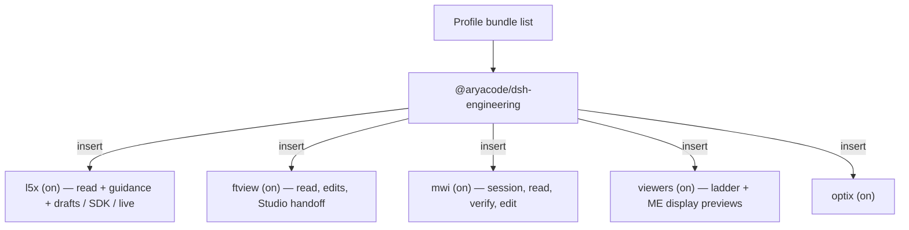

# AryaCode Engineering

**One bundle for automation-engineering work in AryaCode.** Studio 5000 L5X, FactoryTalk View ME,
MotionWorks IEC and FactoryTalk Optix sit behind a single install, one row per surface. A row is the
switch: disable it and that plugin unloads, so its tool schemas leave the request.

`@aryacode/dsh-engineering` · 105 tools · 6 rows · 4 products · MIT

**New here? Start with [Getting started](docs/getting-started.md)** — what each row needs, the loop every
product follows, and the first prompt to paste for each of the four.

---

## Why a bundle

A general assistant pays for every tool schema on every request. An automation engineer needs deep
surfaces — reading a 3 MB L5X, comparing two projects, staging ladder edits, talking to a controller —
but only one or two of them at a time.

This bundle splits those surfaces into one row per product. The expensive surfaces are switches inside
the row. They ship on by default so a fresh install can use every tool; switch off what a
read-only or low-context profile does not need:

| Product row | Config option | Default | What turning it on adds |
|---|---|---|---|
| `l5x` | `editing` | on | the nine `draft_*` schemas |
| `l5x` | `studio` | on | the Logix Designer SDK and supervised controller schemas |
| `l5x` | `live` | on | the EtherNet/IP read, batch, discovery, clock and trend schemas |
| `l5x` | `allowWrites` | on | the two approval-gated writes (tag, wall clock) |
| `ftview` | `edit`, `studio` | on | staged ME edits and the Studio handoff |
| `mwi` | `edit` | on | the seven MotionWorks edit schemas |
| `optix` | `allowWrites`, `allowDestructive`, `allowInvoke`, `preview`, `ocrExecutable` | on | Studio authoring, destructive ops, method invocation, emulator preview and OCR when Tesseract is set |

The previews are independent of the tools — switching a product off does not remove the ladder viewer.
Both previews mount from **one** row (`viewers`), because a package registers exactly one browser
bundle.

## What it supports

| Product | Tools | Default | Needs |
|---|---|---|---|
| **Studio 5000 L5X** | 44 | all on | Node for offline reads; Studio 5000 + Logix Designer SDK for SDK work; a controller for live |
| **FactoryTalk View ME** | 22 | all on | Node for an export folder; FactoryTalk View Studio ME for discovery and the handoff |
| **MotionWorks IEC** | 24 | all on | MotionWorks IEC 3 Pro installed; verified against 1.19 |
| **FactoryTalk Optix** | 10 (3 need preview) | all on | Optix Studio installed; Tesseract for OCR |
| **Engineering resources** | 2 | all on | none; a profile needs an L5X or FactoryTalk View project open |

Tool groups, by product:

- **L5X** — 13 read (`open_project` … `document_project`), 11 staged drafts (`draft_*`, `compose_rung`), 6 Logix
  Designer SDK, 7 supervised controller, 7 live EtherNet/IP (2 reads, 2 identity/discovery, 1 batch read, 2 approval-gated writes)
- **FactoryTalk View** — 12 read, 5 staged edits, 3 Studio handoff
- **MotionWorks IEC** — 7 session, 7 saved-project reads, 3 verify, 7 direct edits
- **Optix** — 10 tools, linked to the `factorytalk-optix` guidance; `optix_netlogic` reads the pinned NetLogic cheat-sheet snapshot, and the 9 bridge tools need Studio
- **Engineering resources** — 2 tools and the `engineering-standards` skill: `engineering_reference` reads the
  local 34-page corpus (IEC 61131-3, Rockwell, Yaskawa, HMI, Optix, craft) and `engineering_profile` infers the
  open project's own naming, idioms and HMI palette, with evidence and a confidence level

## Switches

A row is a plugin. Disabling it in the profile (or on the Plugins page) unmounts that product and its
tool schemas stop being sent. Each product's optional surfaces are config on the same row, so the
cheap decision — is this product on at all — takes one switch, and the fine decision lives one level
down:

| Row | Mounts | Config options (default) |
|---|---|---|
| `l5x` | offline reads, checks, comparison and the `rockwell-l5x` guidance; optionally drafts, SDK, live (reads, batch, discovery, clock) and supervised writes | `editing` (on), `studio` (on), `live` (on), `allowWrites` (on) |
| `ftview` | FactoryTalk View ME read, guidance and edits; optionally the Studio handoff | `edit` (on), `studio` (on) |
| `mwi` | MotionWorks IEC session, reads, verify, guidance and the edits | `workspace` (empty), `edit` (on) |
| `viewers` | ladder + ME display previews | — |
| `engineering-resources` | the engineering corpus, the house-style profile and the `engineering-standards` skill; no project of its own | `reference` (on) |
| `optix` | FactoryTalk Optix Studio authoring and the NetLogic reader | `bridgeUrls` (8768), `bridgeToken` (empty), `allowWrites` (on), `allowDestructive` (on), `allowInvoke` (on), `preview` (on), `allowPreviewInput` (on), `cdpUrl`, `previewUrl`, `ocrExecutable` (empty), `ocrLanguage` (`eng`), `ocrTessdataDirectory` (empty), `netlogic` (on) |

**Why the row list collapsed.** The Plugins page lists a bundle's rows flat and skips `cordis:group`
containers (`plugin-manager/src/index.ts`: *"Group rows are containers … their children carry the
switches"*), so a group switch is a shell feature, not a bundle one. Five product rows with config is
what a bundle can do on its own — no harness change to carry across DSH upgrades.

**No capability policy.** Earlier releases also carried a per-skill tool filter (`policyOnly` /
`toolPolicy`) that gated tools by skill state. That filter is an AryaAI harness feature and is **not
part of this product line** — `@deepseek-ai/dsh-tool-skill` here has no such config. Rows are the
switch. Do not re-add a patch entry that targets another bundle's row: composition fails when the row
is absent, and that is what made 0.4.0 and 0.4.1 uninstallable.

The reference in [docs/reference/tools.md](docs/reference/tools.md) is generated from the registered
definitions, and `pnpm test` fails when the committed reference drifts.

## Status

Where each surface actually stands, based on what has been exercised.

**Working and verified**

- L5X offline reads, references, usage, checks and comparison against revision 19+ projects
- Staged L5X editing — eleven `draft_*` tools, the instruction catalog, `compose_rung`, validation and one new file on apply
- Logix Designer SDK: a real ACD exported to a 3.0 MB L5X against SDK v37
- Supervised controller access — upload, mode change and download behind per-call approval, with
  downloads accepting only a verification id produced by a passed build
- Live EtherNet/IP: polling, one-request batch reads of up to 64 tags, controller identity and clock, LAN discovery, and a bounded trend
- Supervised live writes: `write_live_tag` and `write_controller_clock` need the row's `allowWrites` switch **and** per-call human approval, and report the value the controller reads back
- FactoryTalk View ME: export reads, structural checks, comparison, display and tag edits, display and
  object authoring, vendor-schema validation, the vendor export path and object-level import
  verification; commissioned on a real Studio export (18 displays, 361 tags, no parse errors) and a
  real application export (13 displays, 19 files, 74 applications listed)
- MotionWorks IEC: verified live against 3 Pro 1.19 — direct open with a verified pre-edit backup
  under `.motionworks/attached`, attach-without-reload to a project the IDE already has open, start,
  worksheet, close, saved-project reads, compile diagnostics, code replacement, declaration add, POU
  create/delete, block insertion and a POU package export/delete/import round trip
- Ladder viewer and FactoryTalk View display preview

**On by default** — every tool surface mounts on a fresh install. Switch one off from the row's
Configure page in Plugins (`l5x` editing/Studio/live/allowWrites, `mwi` edit, `optix` authoring/preview)
when the profile is read-only or the request budget is tight. Tool schemas are sent on every request, so
the lean profile is the one that turns them off.

**Known limits** — stated in the bundle, not hidden:

- Live reads, SDK builds and live writes cannot establish that online logic matches the export; every result says
  so in `coverage`
- FBD/SFC semantics are not exercised
- FactoryTalk View **import and runtime creation are Studio steps**: the bundle exports through the
  vendor engine, authors and schema-validates the displays, writes the `BatchImport` manifest, and
  verifies the import object by object afterwards; it does not import or build a `.mer`
- The vendor export does not include the HMI tag CSV, so tag bindings cannot be checked from a fresh
  export unless that database is exported separately
- Optix is linked to a skill now: the `factorytalk-optix` guidance plus the NetLogic reader; the bridge tools still follow the `optix` row config and the Studio bridge

**Not in this repository** — CAD mounts as an independent plugin.

## Milestones

| Version | What landed |
|---|---|
| **0.8.0** | FactoryTalk View authoring: export through the vendor engine, author displays and objects in a schema-validated tree, stage a `BatchImport` handoff, and verify the import object by object |
| **0.7.0** | Ladder generation that cannot emit invalid NeutralText: an instruction catalog, a pattern/tree composer that resolves and type-checks every operand, rung comments read and written, and a documentation bundle (`document_project`) with the Studio tags-and-comments CSV |
| **0.5.0** | Commissioned on real files: FactoryTalk View reads genuine Studio exports (`<gfx>` displays, comma CSVs, UTF-16) instead of reporting zero; L5X alias resolution cuts 315 false "unresolved reference" findings to 16 on a 1279-tag project; `add_tag` no longer demands a value; a locked ACD exports from a copy |
| **0.4.17** | MotionWorks edits the real project again: the pre-edit backup is written where the bridge and engine verify it, an already-open project is attached instead of reloaded, and `mw_get` returns the body hash the edit takes |
| **0.4.15** | Every tool surface ships on by default; the row Configure pages switch them off |
| **0.4.4** | One row per product: five rows, optional surfaces moved into each row's config |
| **0.4.0** | Both previews fold into the bundle's own client face — one package, one browser bundle, 16 rows |
| **0.4.6** | Full EtherNet/IP surface: batch reads, discovery, controller clock, and approval-gated tag and clock writes; 84 tools |
| **0.3.0** | FactoryTalk Optix becomes a bundle component; 79 tools total |
| **0.2.0** | MotionWorks IEC ports into the bundle — 24 tools over the COM bridge and saved-model engine, verified live; edit off by default |
| **0.1.2** | Harness filesystem contract fixed across L5X and FactoryTalk View; every L5X tool linked to its capability by name; generated tool reference, examples and architecture docs |

## Install

Install **Engineering** from the market (**Plugins → Arya Plugin Market → Engineering** → Install or
Update), then open a chat. The bundle carries its components (`vendor/`), its own browser face (both
previews) and the rows; installing a component on its own gives you tools **without** the rows that
switch them.

Manual install, for a profile managed by hand:

```sh
# in the AryaCode profile
pnpm add @aryacode/dsh-engineering
```

```jsonc
// profile package.json
"dsh": { "profile": { "bundles": ["@aryacode/dsh-engineering"] } }
```

Then, in the application, the **Engineering** card lists each row as a component. Per-row enable state
lives in the profile, so disabling a row survives the next update.

First session after install: open the workspace folder that holds your export or project, then ask in
plain language — "open Line.L5X and run the checks", "list the FactoryTalk View ME applications", "find
the MotionWorks projects here". The agent picks the product's skill and tools; [Getting
started](docs/getting-started.md) has the exact prompts and the boundaries.

For development, clone this repository, `pnpm install`, and link it into a profile bundle list; the
development home mounts the same rows.

## How it composes

The bundle adds one loader layer after the Web app: it **inserts** its own rows and never touches a row
another bundle owns.



Row ids are stable. Profiles and patches address these ids, so per-row enable state survives upgrades
even when the implementation behind a row is replaced.

| Row id | Package entry | Config options |
|---|---|---|
| `l5x` | `dsh-engineering-l5x` | `editing` on · `studio` on · `live` on · `allowWrites` on |
| `ftview` | `dsh-engineering-ftview` | `edit` on · `studio` on |
| `mwi` | `dsh-engineering-mwi` | `edit` on |
| `viewers` | `@aryacode/dsh-engineering` (its own client face: ladder + ME display previews) | — |
| `optix` | `@aryacode/dsh-engineering/optix` (wraps the prebuilt `@aryacode/dsh-tool-ft-optix`) | `allowWrites` on · `allowDestructive` on · `allowInvoke` on · `preview` on · `netlogic` on |

## Safety

- **Read-only by default.** Reading, checks, comparison and the viewers never change a controller.
- **Edits write new files.** `draft_apply` writes one new L5X beside the source and refuses to
  overwrite; `ftview_apply` writes a new export folder and leaves the source untouched. MotionWorks
  edits write the real workspace project, after one complete backup under
  `<workspace>/backups/motionworks/`, and verify unrelated saved and native state.
- **One backup tree.** Every product backs up into
  `<workspace>/backups/<product>/<subject>/<UTC stamp>/` with a `backup-manifest.json` naming each
  copied file and its SHA-256, so "back up this project" means the same place in every skill.
  MotionWorks takes its backup on open; L5X, FactoryTalk View and Optix take one on request and before
  an in-place change. `<workspace>/_backups` and `<workspace>/backups/<project>/…` are older layouts
  and are never written.
- **Controller changes need a human.** Upload, mode change and download require per-call approval and
  a session policy that permits asking. The tools refuse before contacting a controller when approval
  is unavailable, and a download accepts only a verification id produced by a passed build.
- **Live writes take two keys.** `write_live_tag` and `write_controller_clock` need the row's
  `allowWrites` switch *and* approval for that exact write; the tag is validated against the export
  first and the result is the value the controller reads back (`WRITE_NOT_VERIFIED` if it differs).
- **No hidden vendor execution.** The FactoryTalk View Studio handoff returns a manual import plan; it
  does not run a vendor utility.
- **Coverage is stated.** Every result names what it cannot establish, including whether online logic
  matches the export.

## Requirements

| Surface | Needs |
|---|---|
| L5X read, references, checks, drafts | Node only; reads `.L5X` revision 19 or later |
| L5X Studio SDK | Studio 5000 with the Logix Designer SDK service, FactoryTalk Linx, .NET |
| L5X controller | Reachable controller, FactoryTalk Linx, a matching uploaded ACD |
| L5X live | A reachable controller over EtherNet/IP; no Studio, Linx or ACD |
| FactoryTalk View read, edit, author | Node only; a FactoryTalk View ME export folder, plus an installed `Gfx-ME*.xsd` for schema validation |
| FactoryTalk View export | FactoryTalk View ME Studio installed on the host (the export server runs without an open window) |
| FactoryTalk View Studio | FactoryTalk View Studio ME for discovery and the manual import |
| MotionWorks IEC | MotionWorks IEC 3 Pro; the 32-bit COM bridge and the Python saved-model engine |
| Optix | FactoryTalk Optix Studio |

## Documentation

| Document | Owns |
|---|---|
| [Getting started](docs/getting-started.md) | The first session: what each row needs, the shared loop, and a paste-ready prompt per product |
| [Engineering resources](docs/resources.md) | The 34-page standards corpus, its rule IDs, the generated index, and the house-style profile |
| [Workflow handbook (PDF)](docs/handbook/Engineering-Handbook.pdf) | The whole surface as a printable handbook with the four workflow diagrams; [editable DOCX](docs/handbook/Engineering-Handbook.docx) and [HTML](docs/handbook/Engineering-Handbook.html) beside it |
| [Tool reference](docs/reference/tools.md) | Every tool, parameter and description (generated) |
| [Examples](docs/examples.md) | End-to-end sessions per product |
| [Architecture](docs/architecture.md) | Composition, row model, configuration, client faces, packaging |
| [L5X port](docs/port/l5x.md) | L5X port decisions and measurements |
| [FTView port](docs/port/ftview.md) | FactoryTalk View port decisions |
| [MotionWorks IEC port](docs/port/mwi.md) | MWI migration design, phases and inventory |
| [Packaging](docs/port/packaging.md) | How the bundle is packed and pinned |
| [Retirement](docs/port/retirement.md) | What "gone" means for a retired plugin |
| [Changelog](CHANGELOG.md) | Released and unreleased changes |

## Development

```sh
pnpm install
pnpm build:client  # regenerate lib/client.js from the committed face bundles
pnpm test          # patch, docs, tool-reference, manifest and client-face checks
pnpm docs:tools    # regenerate the tool reference from the registered definitions
pnpm docs:check    # fail if the committed reference has drifted
python scripts/gen-diagrams.py   # regenerate docs/diagrams/*.svg and *.png
python scripts/gen-handbook.py   # rebuild the PDF, DOCX and HTML handbook from those figures
```

The diagrams and the handbook are generated, not hand-drawn: layout lives in
`scripts/gen-diagrams.py` and the prose in `scripts/gen-handbook.py`, so a changed workflow is one edit
and one regeneration. Both need Pillow; the handbook also needs python-docx and reportlab.

Tests run through `tsx` so they can read the TypeScript tool factories. A registered tool that no
skill governs fails the suite — the policy is a test, not a convention.

## Licence

MIT. See [LICENSE](LICENSE).
