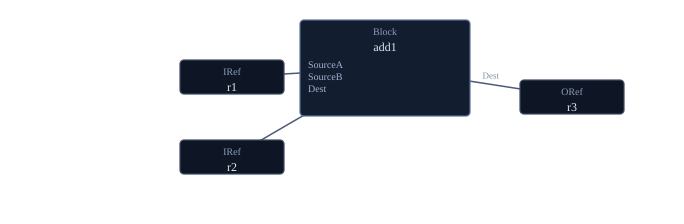
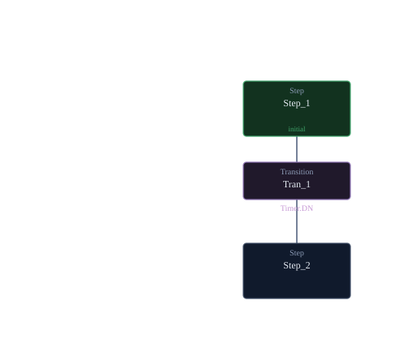

# Capabilities, shown

Every image on this page was produced on this machine by the bundle itself, or by the vendor IDE opening what the
bundle wrote. Each caption names the call that produced it, so a picture can be traced back to a tool and a file rather
than to a marketing claim.

Two rules the rest of this page follows:

- **A picture shows one thing.** The caption says what it proves and what it does not. A screenshot of a chart that
  compiles is not a statement about how that chart runs.
- **Nothing customer-specific is shown.** The L5X figures come from the export committed with this repository
  (`packages/l5x/test/fixtures/sample.l5x`); the Studio figures come from a synthetic benchmark project
  (`E2E_Standard`); the display figure is a display authored for this bundle's own test bed.

## Studio 5000 L5X

### The project viewer, which is where composed logic is read

Four figures, all screenshots of the **shipped** `packages/viewer/lib/client.js` in headless Chrome, mounted through the
same document-preview contract the shell uses, on the committed test exports. They are regenerated by
`pnpm docs:figures`, so a stale figure is a diff rather than a slow lie.

Ladder: `MainProgram/MainRoutine` of the committed test export, with the organizers, the rung comments, an AOI call
labelled from its own parameter list, and **Copy all rungs as NeutralText** in the toolbar — the one action that turns
the pane into something Studio accepts.

Structured Text: the same export's `FaultHandler`, shown as a body rather than as a diagram.

Function block: `Main/Fb` of the diagram fixture, drawn from the geometry the export records — two input references
left, the `ADD` block with its three visible pins, the output reference right, and the pin name on the wire.

Chart: `Main/Chart` of the same fixture — two steps, the initial-step marker, and the transition's Structured Text
condition written under it. The two diagram figures are **vector**: `docs:figures` captures the SVG element the pane drew,
so the document shows the renderer's own output rather than a picture of it.

What these prove: the export parses client-side, the ladder, the Structured Text, the sheet and the chart all draw, and
each language carries its own copy affordance. What they do not prove: execution, live values (the numbers shown are
what the export recorded), or that the pane is what Studio itself would draw.

### Pasting a composed rung into Studio 5000

A composed rung reaches Studio as text, and the editor has to be told which text it is:

1. Open the routine, select the `(End)` rung and press **Enter** to open the rung editor.
2. Set the editor's format dropdown from **In ASCII Text** to **In Neutral Text**. This is the step that matters: a rung
   typed into *ASCII Text* is rejected with `Invalid or unrecognized instruction`, and Studio replaces it with an
   `Unknown Instruction` placeholder — even when the text itself is correct.
3. Type or paste the composed NeutralText — `XIC(Run)TON(Timer,2000,0);` — and accept it.
4. **Build** (`Ctrl+B`).

The figure is the result: rung 4 holding the composed logic and the Errors pane at **0 errors, 0 warnings, 0 messages**,
on `E2E_Standard` in a 5069-L320ER at revision 37.11.

What it proves: the text this bundle's composer emits is what Studio accepts, and a project builds clean with it. What it
does not prove: that the preset the rung names suits the machine, that the logic does what the comment says, or anything
about runtime — a build verdict is a syntax-and-reference verdict, nothing more.

### Reviewing logic you did not write

`l5x_routine_diagram` draws a routine from the parsed rungs, so an unfamiliar program can be read as a picture before
anyone opens Studio.

The figure is `l5x_routine_diagram` on `MainProgram/MainRoutine` of the committed test export: seven rungs, each with
its comment, its instruction mnemonics and its resolved operands — `XIC(StartPB)` sealing in through
`OTE(SystemRunning)`, an AOI call, `CTU(CycleCounter,1,100)`, `TON(MainTimer,1000,0)`, `OTU(MainTimer.TT)` and
`MOV(60.0,LineSpeed)`.

What it proves: the export parses, the rung text is understood, and the operands resolve. What it does not prove: this
is a schematic drawn from the parsed text, not a Studio rendering, and it says nothing about how the logic executes.

### Composing a function block sheet, drawn by the vendor IDE

`draft_fbd` staged one sheet — an `ADD` block `add1` whose instance tag carries the `FBD_MATH` structure, two input
references `r1` and `r2`, one output reference `r3`, and wires naming the pins `SourceA`, `SourceB` and `Dest`.
`draft_apply` wrote it and `verify_offline_l5x` imported and built it with **0 warnings / 0 errors**. The picture is
Logix Designer 37 opening that ACD and drawing the sheet: the block with its three pins, both inputs wired in, `Dest`
wired out.

What it proves: the XML the composer emits is the sheet the IDE draws. What it does not prove: function-block execution
semantics — `coverage` says so on every result.

### Composing an SFC chart — and the defect looking at it found

The first chart this bundle composed contained two steps and drew **one box**. `draft_sfc` had defaulted every step to
`X=300, Y=100`, so `Step_1` and `Step_2` were written at the same point. Studio does not object — coordinates are
presentation, not structure — so the SDK build reported 0 warnings and 0 errors, and no test could see it.

The fix lays steps out down the sheet at a 200 pitch and puts each transition between the steps its links join. The
same composition now draws `Step_1` (initial), `Tran_1` with its `Timer.DN` condition, and `Step_2` in three places.
This pair is kept deliberately: it is the argument for looking at output, not only for building it.

What it proves: the chart compiles and is drawn as three separate elements. What it does not prove: chart execution —
which Studio itself only demonstrates at run time.

## Evidence per surface

Each product has its own level of evidence — stated plainly, because a figure borrowed from another surface is
worse than no figure.

| Surface | Captured here | Drawn here | Where to read |
|---|---|---|---|
| Studio 5000 L5X | the project viewer drawing four languages; a composed rung pasted as Neutral Text and built **0/0**; the IDE drawing a composed FBD sheet and SFC chart | `docs/diagrams/l5x.svg` | [Tool reference](reference/tools.md), [L5X port](port/l5x.md) |
| FactoryTalk View ME | a display authored with the draft tools and rendered by this bundle's own renderer | `docs/diagrams/ftview.svg` | [Any application](reference/ftview-any-app.md), [Cross-reference](reference/ftview-cross.md) |
| MotionWorks IEC | **none.** This host has no MotionWorks IEC install with a reachable IDE bridge, so there is no capture to show and none is faked | `docs/diagrams/mwi.svg` | [Tool reference](reference/tools.md), [MWI port](port/mwi.md) |
| FactoryTalk Optix | **none.** The Studio bridge answers `Bridge unavailable` on this host | `docs/diagrams/optix.svg` | [NetLogic](optix-netlogic.md), [Tool reference](reference/tools.md) |
| ECAD electrical prints | the committed read-only face driven in headless Chrome — 11 shots (light and dark, fit, keyboard and wheel zoom, drag pan, layer hide, text search) with zero page errors, and AryaCAD Electrical's own sample and template drawings read through the review tools out of tree; the 34-sheet write → re-read round trip is the `corpus` spec, deliberately not run in this pass; the in-app capture follows the Dev pass | — (no diagram yet) | [ECAD port](port/ecad.md), [AryaCAD bridge](aryacad-bridge.md), [Tool reference](reference/tools.md) |

The two empty rows are the honest state of this repository, not a judgement about the tools: both surfaces have tests
against fixtures and a documented tool set, and neither has been photographed doing the work. When either is captured,
it replaces the row.
## FactoryTalk View ME

### Authoring a display, rendered by the bundle's own renderer

The display was staged with the `ftview_draft_*` family — real push buttons with per-state colours, a value lamp, a
visibility banner and navigation buttons — and drawn by the bundle's display renderer, which reads the same `<gfx` tree
the vendor export carries.

What it proves: object geometry, state colours, captions and visibility survive as authored, and a reviewer can judge a
screen without a PanelView terminal. What it does not prove: terminal behaviour, vendor-widget fidelity, or that an ME
runtime will accept the application — import and runtime creation are Studio steps, and the bundle says so.

## How each figure was produced

| Figure | Command or call | Input |
|---|---|---|
| `l5x-routine-diagram.png` | `open_project` then `l5x_routine_diagram {program: "MainProgram", routine: "MainRoutine"}` | `packages/l5x/test/fixtures/sample.l5x` |
| `studio-fbd.png` | `draft_fbd` → `draft_apply` → `verify_offline_l5x` → open the ACD in Logix Designer 37 | synthetic `E2E_Standard` project |
| `studio-sfc-before.png`, `studio-sfc.png` | `draft_routine` + `draft_sfc` → `draft_apply` → `verify_offline_l5x` → open in Logix Designer 37 | the same project, before and after commit `8495915` |
| `ftview-authored-display.png` | `ftview_draft_display_create` + `ftview_draft_object_add` … → `ftview_render` | a display authored for this bundle's test bed |

The Studio figures were taken on a Windows host with Logix Designer 37.11 and the Logix Designer SDK service running;
the build verdict in each case is Studio's own, reported verbatim by `verify_offline_l5x`.

## What an image cannot prove

An image is evidence of a rendering, not of a behaviour. None of these figures establishes that online logic matches the
export, that a chart executes in the order it is drawn, that a display behaves on a terminal, or that a controller will
accept a download. Every tool result carries a `coverage` block naming what it could not establish, and that block — not
a screenshot — is the honest answer to "does this work".
