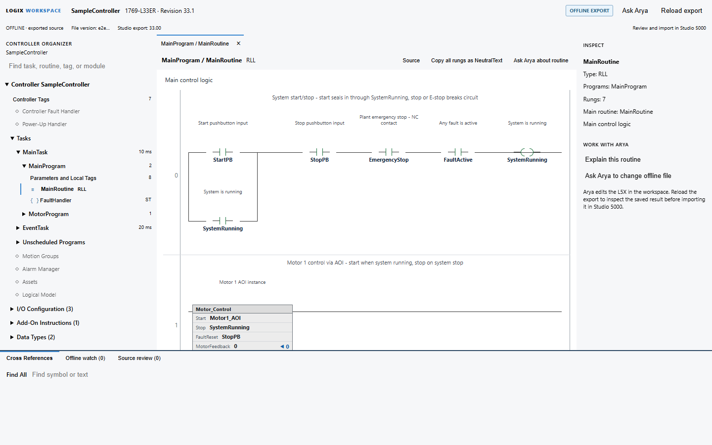
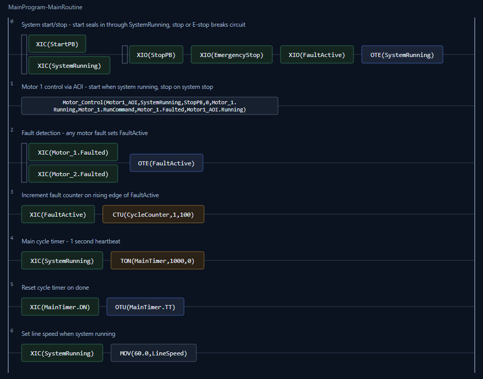
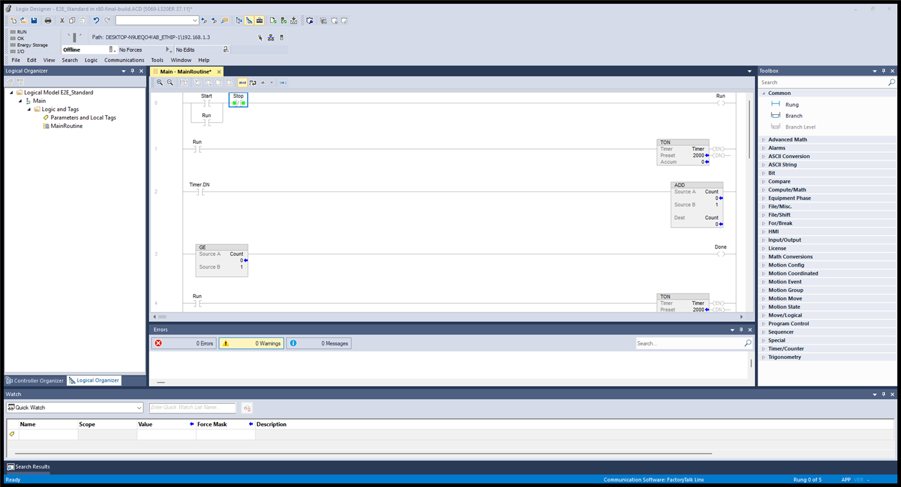

# Example: composing a rung, seeing it, and getting it into Studio

One rung, end to end. The Studio screenshots are captured evidence from this repository's test controller; the tool
answers are the shape `compose_rung` returns, which `packages/l5x/test/compose-program.spec.ts` asserts — not a
transcript pasted from a session, and labelled as such rather than dressed up as one.

## 1. Compose

```
compose_rung(
  program: "Main", routine: "MainRoutine", mode: "insert", rung: 4,
  spec_json: {"series":[{"instr":"XIC","args":["Run"]},{"instr":"TON","args":["Timer","2000"]}]}
)
```

Two operands for the timer, because a caller composing a timer writes two. What comes back:

```json
{
  "summary": "Composed and staged 1 rung(s). Draft 4f1c…: 1 operation(s). Ladder preview at .l5x-preview/Main-MainRoutine.L5X.",
  "data": {
    "draft_id": "4f1c…",
    "operation_count": 1,
    "rungs": [{ "neutral_text": "XIC(Run)TON(Timer,2000,0);", "instructions": 2 }],
    "preview_path": ".l5x-preview/Main-MainRoutine.L5X"
  },
  "next": [
    { "tool": "present", "why": "Show the composed rungs as ladder in the chat, with the NeutralText ready to copy." },
    { "tool": "draft_validate", "why": "Validate the whole draft before writing anything." }
  ]
}
```

Three things to read carefully:

- **The emitted text is `TON(Timer,2000,0)`, not `TON(Timer,2000)`.** Studio's NeutralText carries the accumulator; the
  composer writes it for you. The short form is what Studio rejects — proved the hard way below.
- **`preview_path` is a real file**, written in the same call, so the ladder is in the conversation rather than something
  you have to ask for separately. It is scratch output: the project file still waits for `draft_apply`.
- **Nothing was written to the project.** One operation is staged; `draft_apply` is the only thing that writes.

## 2. See it

The preview document opened in the project viewer — the same renderer the pane uses in the app:



The routine it was composed against, drawn from the parsed rungs — the schematic path, for reading logic without opening
Studio:



## 3. Copy it

In the viewer's toolbar, **Copy all rungs as NeutralText** puts the whole routine on the clipboard, one rung per line.
Per-rung, per-instruction and per-operand copies sit on the same pane, so you can take one rung or all of them.

For a function block sheet or a chart there is no NeutralText to paste — Studio's *Paste ASCII / Neutral Text* does not
apply to them — so those panes offer **Copy routine L5X** instead, which copies the `<Routine>` element the composer
wrote.

## 4. Paste it into Studio 5000

The step that is easy to get wrong, and the reason this example is worth writing:

1. Open the routine, select the `(End)` rung, press **Enter**.
2. In the rung editor, change the format dropdown from **In ASCII Text** to **In Neutral Text**. Text typed into *ASCII
   Text* is rejected with `Invalid or unrecognized instruction` and replaced by an `Unknown Instruction` placeholder —
   even when the text is correct. This is what cost this work several attempts: the text was right and the box was wrong.
3. Paste `XIC(Run)TON(Timer,2000,0);` and accept it.
4. Build (`Ctrl+B`).

The result, on `E2E_Standard` in a 5069-L320ER at revision 37.11:



`0 errors, 0 warnings, 0 messages`.

## What this chain proves, and what it does not

It proves the composer emits text Studio accepts, that the viewer draws that logic, that the toolbar hands you the text
without transcription, and that a project builds clean with it. The two Studio figures are captures; the pane figures
are regenerated by `pnpm docs:figures`.

It does not prove:

- **that the rung does anything sensible.** A build is a syntax-and-reference verdict. `TON(Timer,2000)` is valid whether
  or not two seconds is the right delay for that machine.
- **that the preset suits the process.** The number came from the request, not from an engineering calculation.
- **that the logic is what the machine needs** — that is the engineer's judgement, and the reason step 5 of the loop hands
  the human what is human.
- **anything about runtime.** Nothing here ran.
