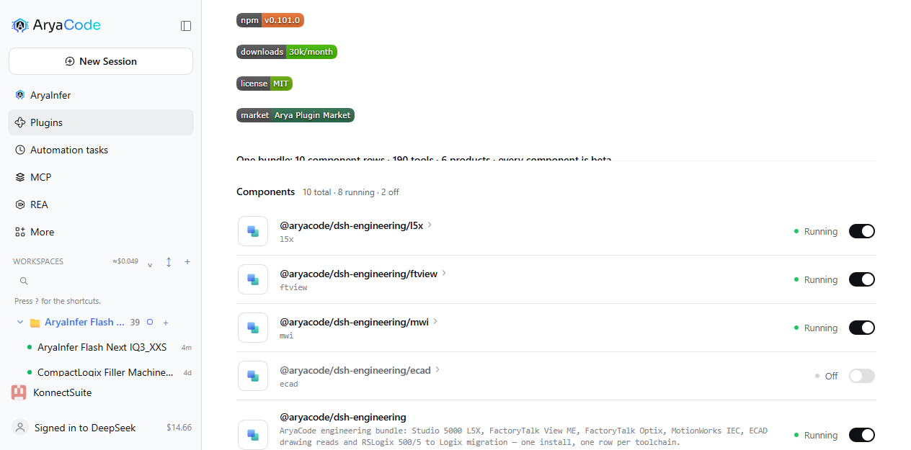
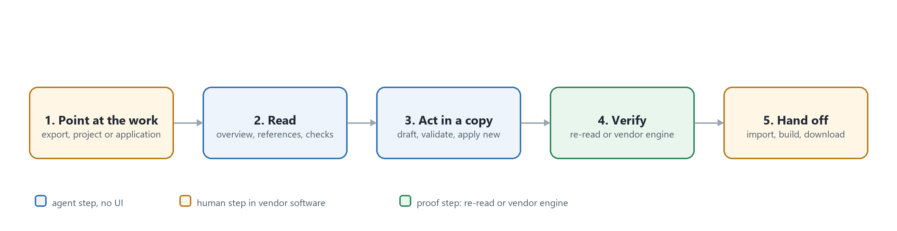
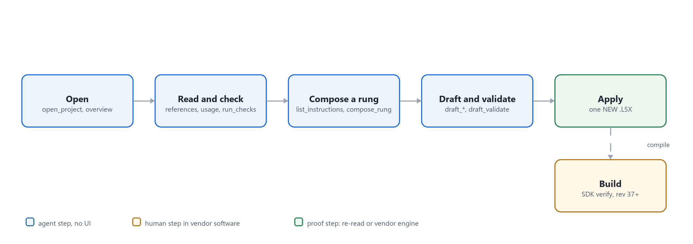
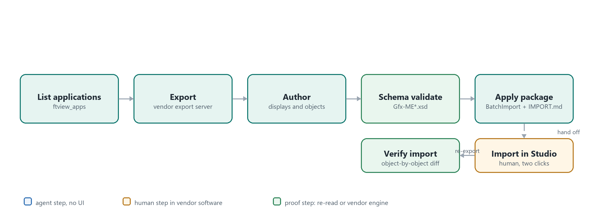
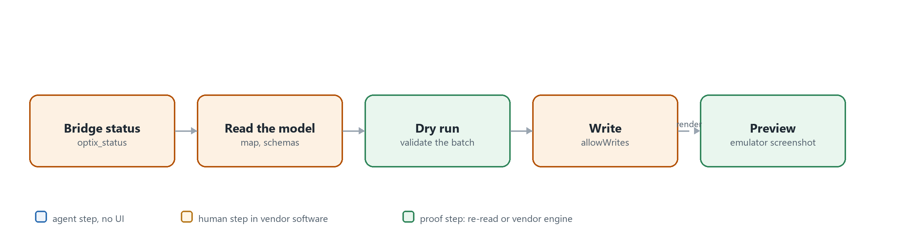
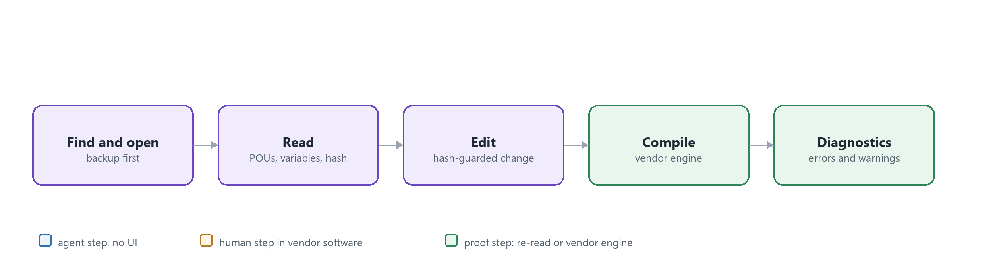

# Getting started

This bundle gives the host eight engineering surfaces behind one install: **Studio 5000 L5X**,
**FactoryTalk View ME**, **FactoryTalk Optix**, **MotionWorks IEC**, **ECAD electrical prints**,
**SLC 500 / PLC-5 → Logix migration**, **RSLogix 5 reads** and the **engineering resources** corpus.
Each product is a *row* you can switch on or off, and each registers
a **skill** (how the agent should work) plus **tools** (what it can do). You do not call tools yourself:
you say what you want in the chat, and the agent loads the skill and the tools that match.

Nine rows, six products: the two support components (engineering resources and migration) are
cross-toolchain, and *viewers* is the surface that draws files rather than talking to a toolchain.

This page is the shortest path from "just installed" to a finished job. The per-product detail lives in
[Products](products/README.md) and [Examples](examples.md).

## 1. Check what you have

You need the host plus whichever vendor software the job touches. Nothing else is required for reading
exports, prints and legacy programs.

| Product | What the agent can do without vendor software | Vendor software it needs for the rest |
|---|---|---|
| Studio 5000 L5X | Read an `.L5X`, review logic, run checks, stage edits into a new `.L5X` | Studio 5000 + Logix Designer SDK for builds; a controller for online work |
| FactoryTalk View ME | Read an export folder, check displays and tags, stage display edits | FactoryTalk View ME Studio to export the application and to import changes |
| FactoryTalk Optix | Nothing: the project is read through the Studio bridge, and the bridge needs Studio | FactoryTalk Optix Studio open with the project loaded, and .NET 8 SDK for compile checks |
| MotionWorks IEC | Read saved projects, code and variables | MotionWorks IEC 3 Pro running for live reads, edits and compile |
| ECAD electrical prints | Read DXF prints, check them, render and compare them | None for reading; DWG goes through the embedded converter; authoring stays in AryaCAD Electrical |
| Migration | Assess `.RSS`/`.ACH`/`.RSP` (or the `.SLC` export), lint a `.L5K`, resolve markers, write the report | None; RSLogix 500/5 only when the hidden automation-server read is wanted |
| RSLogix 5 reads | Nothing without RSLogix 5 for the automation-server path; the container reader answers from the file | RSLogix 5 installed |
| Resources | The standards corpus and the house-style profile | An open L5X or FactoryTalk View project for the profile |
| Preset | The workflow contract, compaction and ledger | Nothing |
| Viewers | The ladder, display and drawing previews | Nothing |

## 2. Install and confirm

Install **Engineering** from the market (**Plugins → Arya Plugin Market → Engineering**), or add
`@aryacode/dsh-engineering` to the profile bundle list. After it loads, the Engineering card lists ten
rows. Eight ship on; `ecad` and `plc5` ship off, because a profile that does not do electrical prints or
RSLogix 5 reads should not pay their context. Turn any row off if the machine has no vendor software for
it.

Confirm the skills are present by asking for one of these in a new chat:

- *"What can you do with a Studio 5000 L5X file?"*
- *"List the FactoryTalk View ME applications on this machine."*

If the answer is "I do not have tools for that", the row is disabled, or the bundle is not loaded. The
Plugins page is the truth: a row reads **Running** only when its entry mounted.

### What it looks like

The Engineering card on the Plugins page, captured on a Dev AryaCode host with the 0.102.0 install —
ten rows, eight running, `ecad` and `plc5` off. That install still carried the `preset` row, which has
since been removed, so both figures below need a re-shoot:

The row named `@aryacode/dsh-engineering` (the `viewers` row) mounts the package root, so it shows the
package name and description instead of a product title, and it owns all three file viewers. Switching a
product row off never removes a viewer; switching that row off removes all three. The rendered README,
including this page's "Where it appears" section, is in
[dev-components-rows.png](images/dev-components-rows.png).

## 3. The loop every product follows

1. **Point at the work.** A workspace folder with the export, project or print set, or an application
   name for FactoryTalk View ME.
2. **Read before writing.** Overview, structure, references, checks. The agent should quote what it read.
3. **Act in a copy.** L5X, FactoryTalk View, Optix screens and ECAD review bundles write **new** files or
   folders and never touch the source; MotionWorks edits the saved project after taking a verified
   backup.
4. **Verify.** Re-read the written file, or run the vendor engine (SDK build, ME re-export, MWI compile,
   Optix build, schema validation). "Done" means the check passed, not that a file was written.
5. **Hand off or download.** Some steps are deliberately human: importing displays in Studio, building
   a `.mer`, compiling a bridge, downloading to a controller. The agent must say which ones.

## 4. First sessions, per product

### Studio 5000 L5X

> Open `C:\Projects\Line\Line.L5X`, give me the overview and run the checks.

Then, for a change:

> Add a seal-in rung for `StartPB`/`StopPB` driving `SystemRunning` in `MainProgram/MainRoutine`, rung 7.

The agent composes the rung with the instruction catalog (`list_instructions`, `compose_rung`), stages it,
validates the whole draft, and applies to a new `.L5X`. With Studio 5000 and the SDK installed, ask for a
build; with a controller, ask for a supervised download. Detail: [L5X](products/l5x.md).

### FactoryTalk View ME

> List the ME applications. Export `Carpenter_EPS_Laminator001` to `C:\Exports\Laminator` and open it.

Then:

> Create a display called "Arya Overview" with a heading, a start button bound to `SystemRunning`, and a
> numeric display for `LineSpeed`. Validate it and write the import package.

The agent exports through the vendor engine (no Studio window needed), authors against the installed
`Gfx-ME` schema, and writes a folder containing the changed displays plus
`Displays/BatchImport_<app>.xml`. **You** import that list in Studio, then:

> Verify the import against my draft.

`ftview_verify_import` re-exports and compares object by object. Detail:
[FactoryTalk View](products/ftview/README.md).

### FactoryTalk Optix

> What Optix project is loaded? Give me the map.

> Add a NetLogic script `LineStats` and bind `LineSpeed` to the label on `MainScreen`.

The agent reads the live model through the Studio bridge, applies typed edits, validates expressions, and
can read NetLogic guidance from the pinned cheat-sheet snapshot. Then:

> Start the runtime and capture the screen, then check it for touch targets and contrast.

The preview chain is four links, and `optix_status` names the first one that is missing: the row's
`preview` switch, a browser (by default the plugin starts Chrome or Edge itself), the project's **Web
presentation engine** serving `previewUrl` while the project runs, and — for canvas text — a host
Tesseract named by `ocrExecutable`. Nothing runs that engine from the command line documented in the
cheat sheet, so `optix_emulator` starts the installed `FTOptixRuntime.exe` against the project folder
instead, and stops only what it started. `optix_ocr_setup` reports that Tesseract install and, on
request, runs it through `winget`; `optix_action` with `ensure_web_engine` adds the engine node a project
lacks. Detail: [Optix](products/optix/README.md), and
[Production readiness](products/optix/production.md) for the release gate.

### MotionWorks IEC

> Find the MotionWorks projects in this workspace.

> Open `BottomCutterS5.mwt` and show me the tasks and POUs.

> In `MainProgram`, change the ramp time from 200 to 150 ms and compile.

The agent starts the IDE, takes a backup under `<workspace>/backups/motionworks/`, edits the saved
project, compiles and reads the diagnostics. Detail: [MotionWorks IEC](products/mwi.md).

### ECAD electrical prints

> Review these drawing prints and give me the findings.

> Which sheets reference `K1`? Build me a review bundle.

The agent reads the DXF (DWG through the embedded converter), indexes sheets and title blocks, proposes
cross-references with a confidence, runs the checks, and writes a review or backup bundle. Authoring a
print is AryaCAD Electrical's job, bridged through its own MCP row. Detail:
[ECAD](products/ecad/README.md).

### Legacy migration

> Assess this .RSS and tell me what the conversion will not carry.

The agent interviews you for the target controller and I/O strategy, assesses the legacy export, watches
the wizard's `.L5K` lint, resolves its conversion markers, and refuses to call it migrated while a
finding stands. Detail: [Migration](products/migration.md).

### RSLogix 5 reads

> Open this .RSP and give me the program census, then the ladder for `PWR_FAULTS`.

The agent opens the project hidden through the vendor automation server, reads program files, ladder,
symbols, I/O footprint, chassis configuration and processor identity, and names what only an online read
or the physical racks can answer. Detail: [PLC-5](products/plc5.md).

## 5. What the bundle will not pretend

- **FactoryTalk View import and runtime creation are Studio steps.** The bundle exports, authors,
  validates and verifies; it does not import into Studio or build a `.mer`. The export copies the alarm
  setup and the tag CSV from the Studio project store; when those files are older than the application
  database the result says so instead of presenting them as current.
- **MotionWorks needs its IDE running.** Without it, the row is read-only over saved files.
- **Optix needs the Studio bridge.** Disk files can be stale while Studio is open; the bridge is the
  truth. `optix_bridge_arm` can put the bridge source into a project that has none, but compiling it and
  right-clicking `StartBridge` are Studio actions no tool can take for you.
- **L5X builds need Studio 5000 and the SDK**, and no surface can prove that online logic matches the
  export or that the machine is safe. Coverage fields say what was not established.
- **Every component is beta.** Each one records in `components.json` what has actually been verified and
  what has not; the [component contract](reference/components.md#maturity) explains the labels.

## 6. Where to read next

| Question | Document |
|---|---|
| Which tool does what, with every parameter | [Tool reference](reference/tools.md) |
| A full session with call shapes and results | [Examples](examples.md) |
| How the rows, services and client faces fit | [Architecture](architecture.md) |
| What changed in a release | [Changelog](../CHANGELOG.md) |
| How the agent should behave for one product | That product's skill (loaded automatically in chat) |
| Why a component exists, and what would split one out | [Components](reference/components.md) |
