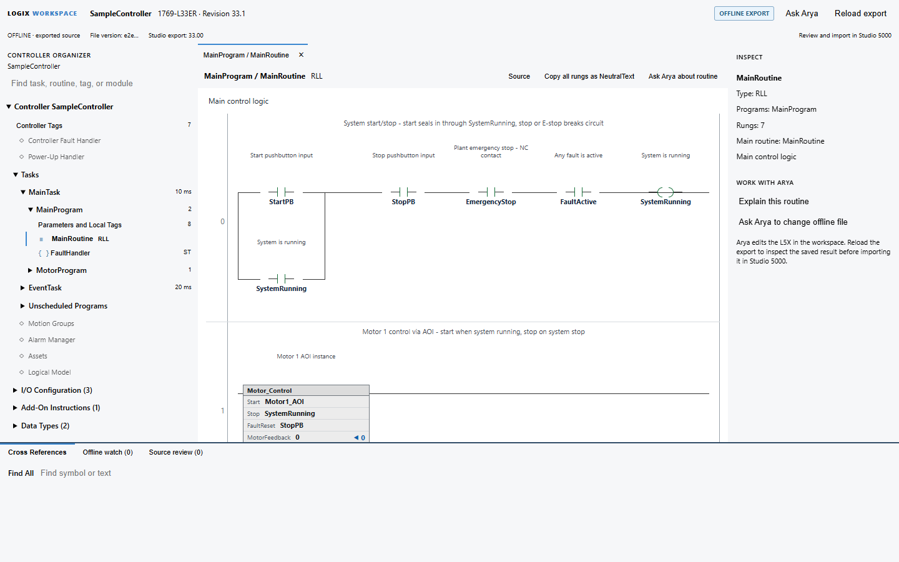

# Documentation

The map. Every page here is either a guide to doing something, a reference that is generated or gated, or a record of a
decision with its evidence — nothing is here to look thorough.

*The viewer this bundle ships, drawing the committed test export: contacts, a branch, a coil, an AOI block with its own
pin names, and **Copy all rungs as NeutralText** in the toolbar. Figures in these pages are screenshots of the shipped
pane, regenerated by `pnpm docs:figures` — [what each one proves, and what it does not](capabilities.md#what-an-image-cannot-prove).*

## Start here

| Page | What it is for |
|---|---|
| [Getting started](getting-started.md) | The first session: what each row needs installed, the shared loop, and a paste-ready prompt per product |
| [Examples](examples.md) | Worked sessions with the exact calls and the answers that came back |
| [Composing a rung, seeing it, and getting it into Studio](examples/composer-to-studio.md) | One rung end to end: the call, the preview, the copy, the Neutral Text paste, and the 0/0 build |
| [Capabilities, shown](capabilities.md) | One figure per surface, the exact call behind it, and the limits of a picture |
| [Architecture](architecture.md) | How the bundle is put together: rows, components, the vendor step, the plugin seam |

## Reports and documents

`document_project` writes two different things, and the difference is the point.

| Output | What it is for |
|---|---|
| The bundle (`PROJECT.md`, `io.*`, `tags*.csv`, `rungs/…`) | Handover and review: Markdown, CSV, and the Studio Tags and Comments shape, so a panel builder or a reviewer can work from it without the project |
| The report (`report.html`, `report.pdf`) | A document: a cover, a table of contents, at-a-glance counts, the ladder drawn **inside** each routine, rung tables, tag and I/O tables |

The report is generated by `packages/l5x/src/engine/report.ts` and printed by the local Chrome or Edge; when neither is
installed the tool writes the HTML and says why it could not print a PDF. Its ladder is the pane's own renderer on paper —
`renderLadderSvg` takes a palette, and `PAPER_PALETTE` is what the document uses — so a report is not a second picture of
the logic. Its sections are declared (`REPORT_SECTIONS`): a report cannot be assembled with one silently missing.

Neither output proves the logic is correct. Every generated document carries that sentence in its footer, because a
document is evidence of what the export *contains*, not of what the machine *does*.
## By surface

Four products, one install. Each has a guide, a tool reference, and — where the export can be read offline — a figure.

| Surface | Where to read |
|---|---|
| **Studio 5000 L5X** | [Tool reference](reference/tools.md) · [Capabilities](capabilities.md) · [Live controllers](live-controller.md) · [L5X port spec](port/l5x.md) |
| **FactoryTalk View ME** | [Working with any application](reference/ftview-any-app.md) · [Cross-referencing HMI against PLC](reference/ftview-cross.md) · [Port](port/ftview.md) |
| **MotionWorks IEC** | [Tool reference](reference/tools.md) · [Port](port/mwi.md) |
| **FactoryTalk Optix** | [NetLogic cheat sheet](optix-netlogic.md) · [Tool reference](reference/tools.md) |

Cross-cutting: [Engineering resources](resources.md) (the 41-page standards corpus, rule IDs and the house-style
profile), [Standards checks](reference/standards-checks.md), and the
[SLC 500 / PLC-5 migration reference](reference/migration.md).

## The agent this ships with

| Page | What it is for |
|---|---|
| [Arya Automation Engineer](preset-arya-automation.md) | The preset that ships with this bundle: the five-step contract, the engineering-tuned compaction, the ledger, and what a preset cannot make true |

## Reference, generated

| Page | What it is for |
|---|---|
| [Tools](reference/tools.md) | Every registered tool, its parameters and its coverage — generated 133 tools at a time, gated by `docs:check` |
| [Components](reference/components.md) | The manifest: each row, its tools, its skill, its probe and its gate |
| [Handbook](handbook/Engineering-Handbook.pdf) | The whole surface as a printable document, with the editable DOCX and HTML beside it |

## Decisions and records

| Page | What it is for |
|---|---|
| [Documentation pipeline](decisions/documentation-pipeline.md) | How PLC Copilot generates documents, reverse-engineered, and what this repository adopts from it |
| [Porting and release](port/packaging.md) · [Retiring a legacy plugin](port/retirement.md) · [One package](handoff-one-package.md) | How the bundle got here, and the rules it follows when it changes shape |
| [MachineAlarms.mal layout](research/machine-alarms-format.md) | Research notes on the format behind the alarm snapshot |

## Figures and assets

| Directory | What it holds |
|---|---|
| `docs/figures` | Screenshots of the shipped viewer (`viewer-*.png`) and the two **vector** diagram figures the pane's own SVG produces (`viewer-fbd.svg`, `viewer-sfc.svg`), plus the IDE and FTView captures |
| `docs/diagrams` | The four surface diagrams and the loop diagram, each as SVG and PNG |
| `docs/handbook` | The printable handbook (PDF, DOCX, HTML) |

Regenerate the viewer figures with `pnpm docs:figures`; regenerate the tool reference with `pnpm docs:tools`. Both are
checked in CI: `pnpm docs:check` fails when the reference drifts from the registry, and the figure script is what keeps a
figure from silently becoming a lie.
