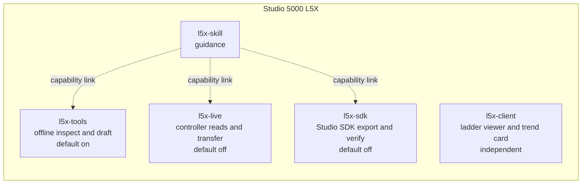
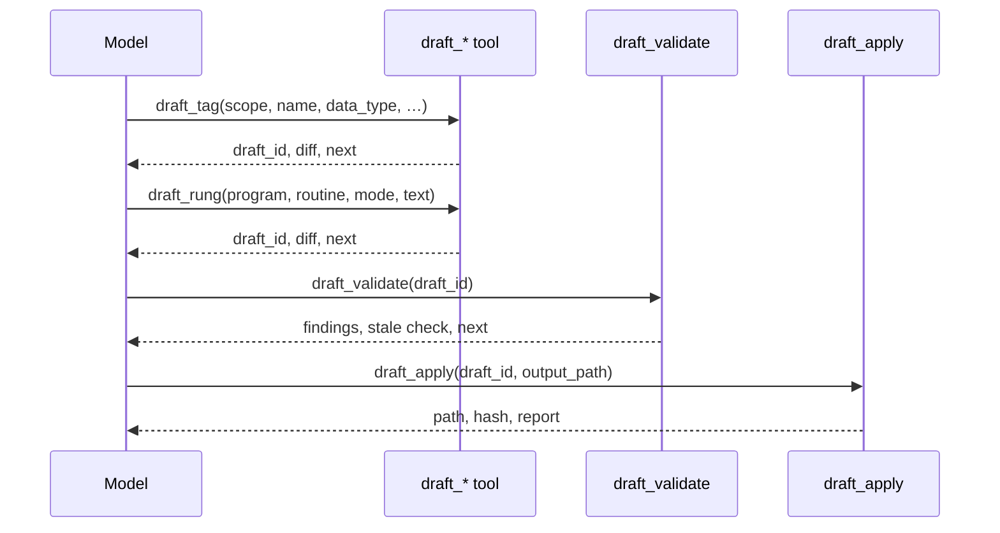

# L5X port specification

Status: **draft for review.** Nothing in this document is implemented. It describes how the Studio 5000 product is rebuilt inside `dsh-engineering`, and why the current surface fails small models.

## 1. Why this port exists

The plugin works when the model is large enough to compensate for it. Against DeepSeek, a session eventually reaches the right tool. Against Qwen3.6 35B, tool calls fail, the model retries the wrong tool, and the same task that succeeded once through the original MCP in Cursor becomes a loop.

The original MCP was not smarter. It had twelve tools with one obvious intent each, arguments documented in the tool text, no state handle to carry, and results a model could read like prose. The port added capability without preserving those properties.

The target is not "more tools, better described." The target is: **a competent small model completes an offline L5X task on the first attempt, without an invalid argument.**

## 2. What we measured

Current release 0.6.2, tools serialized as `name` + `description` + `parameters`:

| Measure | Value |
|---|---|
| Registered tools | 43 |
| Total schema characters | 20,400 (≈5.1k tokens) |
| Parameters | 132 |
| Parameters with a description | **0** |
| Parameters that are JSON encoded inside a string | **9** |
| Distinct error codes | **97** |
| Tools carrying the same operation contract | 3 (`prepare_change_set`, `validate_change_set`, `apply_change_set`) |
| Schema characters those three consume | 3,921 (19% of the total) |
| Skill body | 27,753 characters (≈6.9k tokens, loaded on invocation) |

### 2.1 Overlapping intent

| Intent | Tools that claim it |
|---|---|
| Inspect a project | `project_overview`, `analyze_project`, `run_checks` |
| Find where a symbol is used | `find_references`, `find_parsed_references`, `trace_symbol`, `trace_signal`, `resolve_tag` |
| Draft a change | `propose_change`, `prepare_change_set`, `propose_udt_change` |
| Read a live value | `read_live_tag`, `read_live_dint`, `poll_live_tags`, `sample_live_tags` |

A large model resolves this from the skill body and from failures. A small model picks by name similarity and then retries. Every retry costs a tool call, a result, and attention.

### 2.2 Undescribed parameters

Every one of the 132 parameters reaches the model as a bare type:

```json
"project_id": { "type": "string" }
"request": { "type": "string" }
"tags_json": { "type": "string" }
```

`project_id` has no explanation of what a project id is or where it comes from. `request` has no description of the JSON it expects; the operation contract lives in the tool description instead. `tags_json` has neither a shape nor an example.

### 2.3 JSON inside a string

Nine parameters require the model to serialize JSON, escape it, and pass it as a string:

`prepare_change_set.request`, `validate_change_set.request`, `apply_change_set.request`, `propose_udt_change.request`, `propose_change.request`, `poll_live_tags.tags_json`, `start_plc_trend.tags_json`, `observe_logic.tags_json`, `sample_live_tags.tags_json`.

This is the single most reliable way to make a small model fail: it must construct a nested document as an opaque string, with no schema validation before the call, and any quoting error surfaces as a parse failure rather than a repairable argument error.

### 2.4 Mandatory state

`project_id` is required on 31 tools. The model must call `open_project` first, retain the returned handle across turns, and pass it everywhere. A small model forgets it, passes the file path, or reopens the same file under a second handle. `UNKNOWN_PROJECT` now names the open handles, which is good, but the failure should not be reachable for the common single-project case.

### 2.5 No recovery signal

A failure returns `{"error": "..."}`. The text is often precise (`UNKNOWN_PROJECT` names the open handles) and sometimes not (`SESSION_REQUIRED`, `INVALID_ARGUMENT`). There is no field telling the model what to do next, and no consistent place for candidate names to retry with. With 97 codes, a model cannot learn the taxonomy.

### 2.6 Results without direction

Successful results are pretty-printed JSON. They carry the answer and rarely the next step. The MCP returned a summary a model could read and act on; the port returns a document a model must interpret.

## 3. Root causes, ranked

1. **Ambiguous inventory.** Two or more tools answer the same question, so tool selection becomes a guess.
2. **Parameter semantics are absent.** The model knows a type, not a meaning.
3. **Nested JSON strings.** Serialization and escaping replace reasoning.
4. **Mandatory state handles.** Bookkeeping replaces the task.
5. **No recovery path.** A wrong call produces a dead end rather than a correction.
6. **Description bulk.** Nineteen percent of the schema budget is one operation contract repeated three times.
7. **Everything is always loaded.** Live controller and SDK tools cost the same attention as reading a tag, even in a session that will never touch a controller.

## 4. Design rules

| # | Rule | Acceptance |
|---|---|---|
| R1 | One tool per intent; a second tool that answers the same question is merged or deleted | No cluster in §2.1 survives |
| R2 | Every parameter has a description and an example value | 100% of parameters described |
| R3 | No JSON encoded inside a string, except one documented batch escape hatch | 0 opaque parameters in the default surface |
| R4 | State is optional when it is unambiguous: one open project means `project_id` may be omitted | Opening once is enough for every read |
| R5 | Every error carries code, what failed, and the exact next call; unknown names list candidates | Every refused call is repairable from its result |
| R6 | Every result starts with a summary and ends with concrete next calls | Reads and drafts both |
| R7 | Context cost follows usage: live and SDK tools load only when enabled | Default entry ≤ 12k schema characters |
| R8 | The skill carries decisions and safety, not tool documentation | Skill body ≤ 8k characters |
| R9 | The legacy twelve-tool API keeps its recorded behavior | Parity corpus passes unchanged |
| R10 | A small model completes the offline task suite without an invalid argument | §12 evaluation |

## 5. Entry map

The product splits into five entries. Only the first and the skill are on by default.



| Entry | Contents | Default | Config |
|---|---|---|---|
| `l5x-tools` | Offline reads, checks, drafts | on | `maxFileBytes`, `maxOperations`, `traceLimits` |
| `l5x-live` | Controller reads, trends, snapshot, transfer | off | `polling`, `allowControllerOperations` |
| `l5x-sdk` | ACD export, offline verify, import plan | off | `sdk` paths and timeouts |
| `l5x-skill` | Decision tree and safety | on | — |
| `l5x-client` | Ladder viewer, trend card | independent | — |

The client entry never depends on `l5x-tools`. The viewer imports the isomorphic model from `./analysis`; the tools keep the Node I/O. Switching `l5x-tools` off leaves the viewer working.

## 6. Target surface

### 6.1 `l5x-tools` — offline, default entry

| Tool | Intent | Parameters (all described) | Returns |
|---|---|---|---|
| `open_project` | Open an export | `path` | `project_id`, identity, structure summary, `next` |
| `project_overview` | Structure and coverage | `project_id?`, `detail?` | controller, tasks/programs, counts, analysis coverage |
| `list_components` | Enumerate one kind | `kind`, `scope?`, `filter?`, `offset?`, `limit?` | rows with name, scope, type |
| `get_component` | Read one component | `kind`, `name`, `scope?` | full component detail |
| `search_logic` | Find logic text | `query`, `kind?` | rung/line matches with locations |
| `trace` | References or dependencies | `symbol`, `mode`, `scope?`, `depth?` | readers/writers or upstream graph |
| `resolve_tag` | Resolve an address | `address` | alias chain, member, bit, subscript |
| `usage_map` | Element/bit allocation | `tag`, `element?` | used/free bits |
| `run_checks` | Engineering checks | `project_id?`, `baseline_id?`, `filters?` | findings with counts |
| `compare_projects` | Diff two exports | `left`, `right` | component and logic diff |
| `studio_capabilities` | What this host supports | `project_id?` | capabilities and workflow |
| `draft_rung` | Draft a rung change | `project_id?`, `program`, `routine`, `mode`, `rung?`, `text` | `draft_id`, diff, `next` |
| `draft_st` | Draft a Structured Text body | `project_id?`, `program`, `routine`, `code` | `draft_id`, diff |
| `draft_routine` | Draft a new routine | `project_id?`, `program`, `name`, `language`, `code` | `draft_id`, diff |
| `draft_tag` | Draft a tag | `project_id?`, `scope`, `name`, `data_type`, `description`, `value?`, `dimensions?`, `external_access?` | `draft_id`, diff |
| `draft_tag_description` | Draft a tag description | `project_id?`, `scope`, `name`, `description` | `draft_id`, diff |
| `draft_udt_member` | Draft a UDT member | `project_id?`, `udt`, `name`, `data_type`, `description` | `draft_id`, diff |
| `draft_udt_description` | Draft a UDT or member description | `project_id?`, `udt`, `member?`, `description` | `draft_id`, diff |
| `draft_validate` | Validate accumulated drafts | `draft_id` | findings, stale check |
| `draft_apply` | Write the draft | `draft_id`, `output_path` | written path, hash, report |

### 6.2 `l5x-live` — opt-in

| Tool | Intent | Notes |
|---|---|---|
| `controller_approval_status` | Can this session approve an operation | Unchanged |
| `read_controller_mode` | Mode for an explicit controller | Unchanged |
| `read_live_tags` | Read named scalars | Merges `read_live_tag` and `read_live_dint`; `tags` is an array of names, not JSON |
| `poll_live_tags` | Timed sweeps | `tags` array, explicit `ip_address` and `slot` |
| `start_plc_trend` | Background trend | Same arguments as polling |
| `capture_controller_snapshot` | Upload an ACD | Per-call approval |
| `change_controller_mode` | Program/Run/Test | Per-call approval |
| `download_project` | Download a verified ACD | Per-call approval |
| `read_project_comm_path` | Saved Linx path | Unchanged |

`go_online` retires: read-only diagnostics are `read_live_tags`, and the SDK session adds state without adding capability. `sample_live_tags` retires into `poll_live_tags`.

### 6.3 `l5x-sdk` — opt-in

`studio_sdk_status`, `export_acd_to_l5x`, `verify_offline_l5x`, `edit_offline_acd`, `studio_ide_import_plan`, `studio_review_evidence`.

`edit_offline_acd` is the SDK's own edit path and stays separate from the draft family; the two must not both claim "edit".

### 6.4 Retired names

`find_references` → `trace(mode: references)`; `find_parsed_references` → `trace(mode: references, detail: parsed)` or absorbed; `trace_symbol` → `trace`; `trace_signal` → `trace(mode: dependencies)`; `analyze_project` → `project_overview(detail: coverage)`; `propose_change` → draft family (legacy path keeps it); `prepare_change_set`/`validate_change_set`/`apply_change_set` → `draft_*`; `read_live_tag`/`read_live_dint` → `read_live_tags`; `sample_live_tags` → `poll_live_tags`; `go_online` → retired.

## 7. Contracts

### 7.1 Parameters

Every parameter declares `description` and, where it helps, an `example` in the description text:

```json
"project_id": {
  "type": "string",
  "description": "Handle returned by open_project. Omit when exactly one project is open in this chat."
}
```

No parameter is a JSON string. `tags` is an array of strings. A batch escape hatch, if kept, is one explicitly named tool with a string parameter documented as advanced.

### 7.2 Results

Every result is an object with a stable head and tail:

```json
{
  "summary": "Opened Sample.L5X: 3 programs, 412 tags, 88 routines (revision 36).",
  "data": { "…": "tool-specific" },
  "coverage": { "complete": false, "unverified": ["FBD bodies", "dynamic indices"] },
  "next": [
    { "tool": "project_overview", "why": "Confirm tasks and coverage before editing" },
    { "tool": "list_components", "args": { "kind": "routine" }, "why": "Find the routine to change" }
  ]
}
```

`next` is derived from the tool and the current state, not generic advice. It is the recovery path when the model's plan is thin.

### 7.3 Errors

```json
{
  "error": {
    "code": "UNKNOWN_PROJECT",
    "message": "No project is open in this chat.",
    "fix": "Call open_project with the L5X path, then retry.",
    "candidates": []
  }
}
```

Errors stay results rather than throws. `candidates` lists valid names for ambiguous or unknown lookups. The code is for logs and tests; the message and fix are for the model.

### 7.4 State

- `project_id` is optional on every tool. Resolution order: explicit argument, the single open project, otherwise `UNKNOWN_PROJECT` with the fix.
- `draft_id` follows the same rule.
- Handles expire with the chat, as today.

## 8. Draft lifecycle

One operation per call, accumulated into a draft, validated, then applied. This replaces a 1,000-character operation contract repeated in three tools and a JSON string.



A batch remains possible for scripts and tests through a separate tool, clearly marked as advanced.

## 9. Skill and documentation

- The skill carries the decision tree, safety boundary, and the order of operations. Target ≤ 8,000 characters.
- Tool documentation lives in tool descriptions and results, not duplicated in the skill.
- Deep material stays in `docs/` and is read on demand; the skill links to it.
- The skill is user-invocable and model-invocable, as today.

## 10. Safety

Unchanged and non-negotiable:

- No online edits, forces, bit writes, or runtime data writes.
- Upload, mode change, and download require per-call human approval and fail closed without the approval service.
- Drafts never write the source file; `draft_apply` writes a new path.
- Bounds: `maxFileBytes`, operation counts, result sizes, trace depth, polling duration.

## 11. Compatibility

- The legacy twelve-tool API remains behind `legacyTools: true` with its recorded parity corpus.
- The new surface is a breaking change to tool names and parameters, carried by a major version and an upgrade note.
- The skill, config keys, and client entry keep their ids.

## 12. Test plan

| Layer | Test |
|---|---|
| Schema budget | Registered offline schemas ≤ 12,000 characters |
| Parameters | Every parameter has a description; no JSON-in-string parameter in the default surface |
| Results | Every result has `summary` and `next`; snapshot the text for stable tools |
| Errors | Every error code has a `fix`; unknown-name errors list candidates; test each refusal path |
| Drafts | Accumulate, validate, apply, stale refusal, protected target refusal |
| Parity | Legacy corpus unchanged |
| Real composition | Boot a profile with only `l5x-tools`; assert no live or SDK schemas reach the model |
| Small model | 15 offline tasks against Qwen3.6 35B and DeepSeek; record success, invalid-argument rate, calls per task, wrong-tool rate |

Acceptance for the small-model suite: no invalid-argument failures on well-formed tasks, and ≥ 90% first-attempt task success on the offline set.

## 13. Open questions

1. Does `trace` stay one tool with a `mode`, or split into `references` and `dependencies` if the merged schema confuses models?
2. Is `observe_logic` a real intent or a debugging aid that should retire?
3. Does the batch escape hatch exist at all, or do scripts call `draft_*` in a loop?
4. How much of the SDK entry is actually used in practice? If `edit_offline_acd` is rare, it may retire.

## 14. Sequencing

1. **Read surface** — `open_project` through `run_checks`, with parameters, results, and errors rebuilt. Keep old tools mounted beside the new ones in a dev profile and compare.
2. **Draft family** — replace the change-set JSON string; keep the old path behind a config flag until the small-model suite passes.
3. **Live split** — move the controller tools into `l5x-live`, merge the duplicate reads.
4. **SDK split** — move SDK tools into `l5x-sdk`.
5. **Retire** — remove the superseded names, update the skill, publish the major version.
