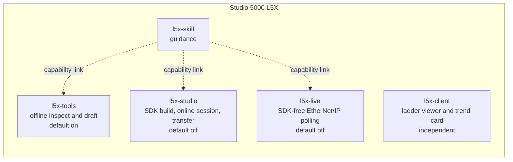
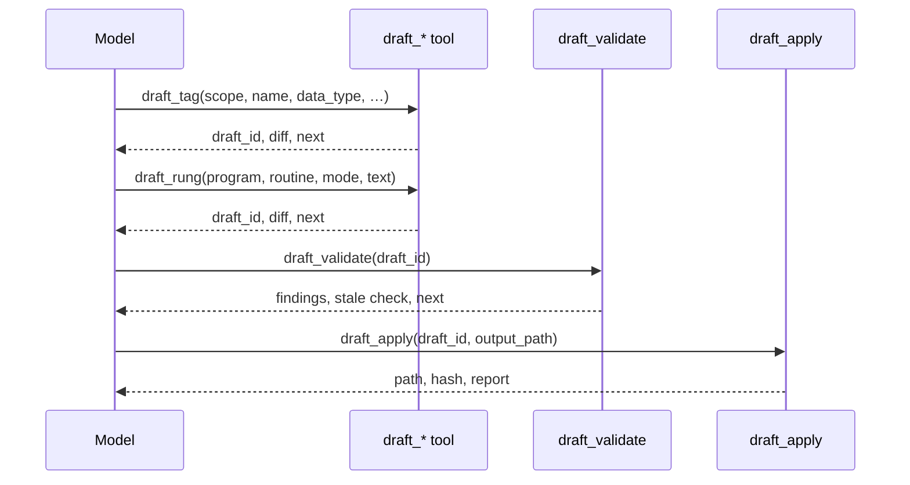
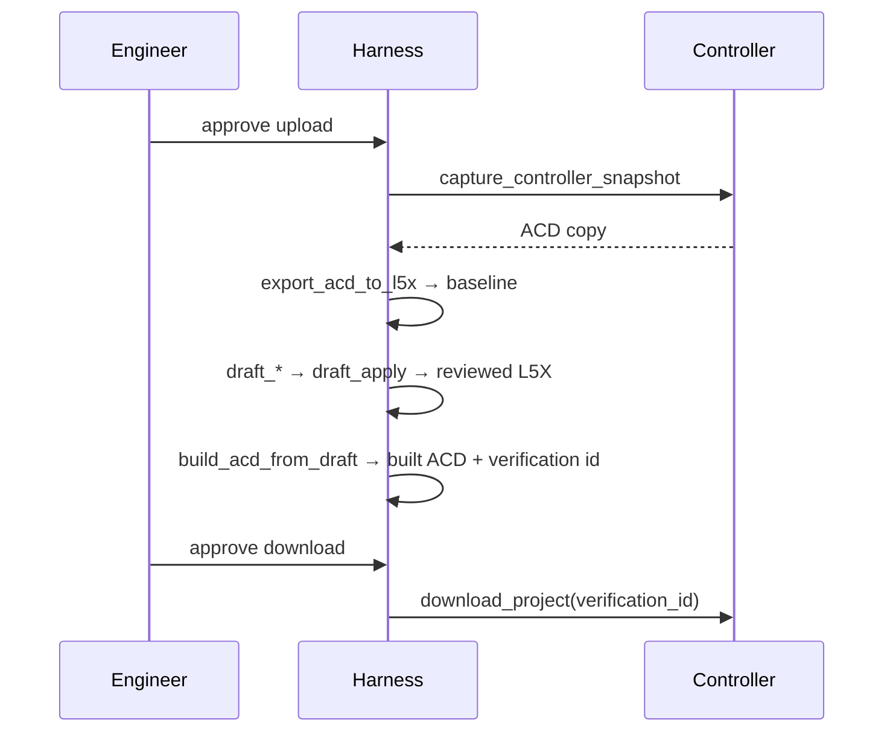

# L5X port specification

Status: **draft for review.** Nothing in this document is implemented. It describes how the Studio 5000 product is rebuilt inside `dsh-engineering`, and why the current surface fails small models.

## 1. Why this port exists

The plugin works when the model is large enough to compensate for it. Against DeepSeek, a session eventually reaches the right tool. Against Qwen3.6 35B, tool calls fail, the model retries the wrong tool, and the same task that succeeded once through the original MCP in Cursor becomes a loop.

The original MCP was not smarter. It had twelve tools with one obvious intent each, arguments documented in the tool text, no state handle to carry, and results a model could read like prose. The port added capability without preserving those properties.

The target is not "more tools, better described." The target is: **a competent small model completes an offline L5X task on the first attempt, without an invalid argument.**

## 2. What we measured

Current release 0.6.2, tools serialized as `name` + `description` + `parameters`:

| Measure | Value |
|---|---|
| Registered tools | 43 |
| Total schema characters | 20,400 (≈5.1k tokens) |
| Parameters | 132 |
| Parameters with a description | **0** |
| Parameters that are JSON encoded inside a string | **9** |
| Distinct error codes | **97** |
| Tools carrying the same operation contract | 3 (`prepare_change_set`, `validate_change_set`, `apply_change_set`) |
| Schema characters those three consume | 3,921 (19% of the total) |
| Skill body | 27,753 characters (≈6.9k tokens, loaded on invocation) |

### 2.1 Overlapping intent

| Intent | Tools that claim it |
|---|---|
| Inspect a project | `project_overview`, `analyze_project`, `run_checks` |
| Find where a symbol is used | `find_references`, `find_parsed_references`, `trace_symbol`, `trace_signal`, `resolve_tag` |
| Draft a change | `propose_change`, `prepare_change_set`, `propose_udt_change` |
| Read a live value | `read_live_tag`, `read_live_dint`, `poll_live_tags`, `sample_live_tags` |

A large model resolves this from the skill body and from failures. A small model picks by name similarity and then retries. Every retry costs a tool call, a result, and attention.

### 2.2 Undescribed parameters

Every one of the 132 parameters reaches the model as a bare type:

```json
"project_id": { "type": "string" }
"request": { "type": "string" }
"tags_json": { "type": "string" }
```

`project_id` has no explanation of what a project id is or where it comes from. `request` has no description of the JSON it expects; the operation contract lives in the tool description instead. `tags_json` has neither a shape nor an example.

### 2.3 JSON inside a string

Nine parameters require the model to serialize JSON, escape it, and pass it as a string:

`prepare_change_set.request`, `validate_change_set.request`, `apply_change_set.request`, `propose_udt_change.request`, `propose_change.request`, `poll_live_tags.tags_json`, `start_plc_trend.tags_json`, `observe_logic.tags_json`, `sample_live_tags.tags_json`.

This is the single most reliable way to make a small model fail: it must construct a nested document as an opaque string, with no schema validation before the call, and any quoting error surfaces as a parse failure rather than a repairable argument error.

### 2.4 Mandatory state

`project_id` is required on 31 tools. The model must call `open_project` first, retain the returned handle across turns, and pass it everywhere. A small model forgets it, passes the file path, or reopens the same file under a second handle. `UNKNOWN_PROJECT` now names the open handles, which is good, but the failure should not be reachable for the common single-project case.

### 2.5 No recovery signal

A failure returns `{"error": "..."}`. The text is often precise (`UNKNOWN_PROJECT` names the open handles) and sometimes not (`SESSION_REQUIRED`, `INVALID_ARGUMENT`). There is no field telling the model what to do next, and no consistent place for candidate names to retry with. With 97 codes, a model cannot learn the taxonomy.

### 2.6 Results without direction

Successful results are pretty-printed JSON. They carry the answer and rarely the next step. The MCP returned a summary a model could read and act on; the port returns a document a model must interpret.

### 2.7 No discovery surface

The 43-tool surface has no tool that lists tags, UDTs, routines, AOIs or modules. `get_component` requires an exact name, and `project_overview` returns counts plus program and task names only. The listing tools — `get_tags`, `get_udts`, `get_routines`, `get_aois`, `list_modules` — exist only in the legacy twelve-tool API.

A model that does not already know a tag name must guess it, search logic text, or read the file outside the conversation. The MCP exposed the inventory; the port dropped it and added analysis tools that assume the names are known.

## 3. Root causes, ranked

1. **Ambiguous inventory.** Two or more tools answer the same question, so tool selection becomes a guess.
2. **Parameter semantics are absent.** The model knows a type, not a meaning.
3. **Nested JSON strings.** Serialization and escaping replace reasoning.
4. **Mandatory state handles.** Bookkeeping replaces the task.
5. **No recovery path.** A wrong call produces a dead end rather than a correction.
6. **Description bulk.** Nineteen percent of the schema budget is one operation contract repeated three times.
7. **Everything is always loaded.** Live controller and SDK tools cost the same attention as reading a tag, even in a session that will never touch a controller.
8. **The inventory is not exposed.** Tags, UDTs, routines and modules cannot be listed, so names are guessed; every guess is a failed call.

## 4. Design rules

| # | Rule | Acceptance |
|---|---|---|
| R1 | One tool per intent; a second tool that answers the same question is merged or deleted | No cluster in §2.1 survives |
| R2 | Every parameter has a description and an example value | 100% of parameters described |
| R3 | No JSON encoded inside a string, except one documented batch escape hatch | 0 opaque parameters in the default surface |
| R4 | State is optional when it is unambiguous: one open project means `project_id` may be omitted | Opening once is enough for every read |
| R5 | Every error carries code, what failed, and the exact next call; unknown names list candidates | Every refused call is repairable from its result |
| R6 | Every result starts with a summary and ends with concrete next calls | Reads and drafts both |
| R7 | Context cost follows usage: live and SDK tools load only when enabled | Default entry ≤ 12k schema characters |
| R8 | The skill carries decisions and safety, not tool documentation | Skill body ≤ 8k characters |
| R9 | The legacy twelve-tool API keeps its recorded behavior | Parity corpus passes unchanged |
| R10 | A small model completes the offline task suite without an invalid argument | §12 evaluation |

## 5. Entry map

The product splits into five entries: three tool sets, the skill, and the client. Only the offline tools and the skill are on by default.



| Entry | Contents | Default | Config |
|---|---|---|---|
| `l5x-tools` | Offline reads, checks | on | `maxFileBytes`, `traceLimits` |
| `l5x-editing` | Drafts: rung, ST, routine, tag, UDT, validate, apply | off | `maxFileBytes`, `maxDraftOperations` |
| `l5x-studio` | SDK build, online session, supervised transfer | off | `sdk`, `allowControllerOperations` |
| `l5x-live` | SDK-free EtherNet/IP polling and trends | off | `polling` |
| `l5x-skill` | Decision tree and safety | on | — |
| `l5x-client` | Ladder viewer, trend card | independent | — |

The split follows mechanism and risk, not the product noun. Offline work needs neither Studio nor a controller. Studio work needs the local Logix Designer SDK and may transfer under approval. Polling needs neither Studio nor an ACD, and never writes.

A session that only reads and drafts therefore pays for the offline schemas, not the whole product.

The client entry never depends on `l5x-tools`. The viewer imports the isomorphic model from `./analysis`; the tools keep the Node I/O. Switching `l5x-tools` off leaves the viewer working.

## 6. Target surface

### 6.1 `l5x-tools` — offline reads, default entry

The `draft_*` rows in the table below are registered by the separate `l5x-editing` entry, off by default. They are shown together because they share one intent: work over an opened export.

| Tool | Intent | Parameters (all described) | Returns |
|---|---|---|---|
| `open_project` | Open an export | `path` | `project_id`, identity, structure summary, `next` |
| `project_overview` | Structure and coverage | `project_id?`, `detail?` | controller, tasks/programs, counts, analysis coverage |
| `list_components` | Enumerate one kind | `kind`, `scope?`, `filter?`, `offset?`, `limit?` | rows with name, scope, type |
| `get_component` | Read one component | `kind`, `name`, `scope?` | full component detail |
| `search_logic` | Find logic text | `query`, `kind?` | rung/line matches with locations |
| `find_references` | Where a symbol is read or written | `symbol`, `scope?`, `detail?` | occurrences with access, confidence, source |
| `trace_dependencies` | What feeds a symbol | `symbol`, `depth?` | bounded upstream graph, explicit truncation |
| `resolve_tag` | Resolve an address | `address` | alias chain, member, bit, subscript |
| `usage_map` | Element/bit allocation | `tag`, `element?` | used/free bits |
| `run_checks` | Engineering checks | `project_id?`, `baseline_id?`, `filters?` | findings with counts |
| `compare_projects` | Diff two exports | `left`, `right` | component and logic diff |
| `studio_capabilities` | What this host supports | `project_id?` | capabilities and workflow |
| `draft_rung` | Draft a rung change | `project_id?`, `program`, `routine`, `mode`, `rung?`, `text` | `draft_id`, diff, `next` |
| `draft_st` | Draft a Structured Text body | `project_id?`, `program`, `routine`, `code` | `draft_id`, diff |
| `draft_routine` | Draft a new routine | `project_id?`, `program`, `name`, `language`, `code` | `draft_id`, diff |
| `draft_tag` | Draft a tag | `project_id?`, `scope`, `name`, `data_type`, `description`, `value?`, `dimensions?`, `external_access?` | `draft_id`, diff |
| `draft_tag_description` | Draft a tag description | `project_id?`, `scope`, `name`, `description` | `draft_id`, diff |
| `draft_udt_member` | Draft a UDT member | `project_id?`, `udt`, `name`, `data_type`, `description` | `draft_id`, diff |
| `draft_udt_description` | Draft a UDT or member description | `project_id?`, `udt`, `member?`, `description` | `draft_id`, diff |
| `draft_validate` | Validate accumulated drafts | `draft_id` | findings, stale check |
| `draft_apply` | Write the draft | `draft_id`, `output_path` | written path, hash, report |

### 6.2 `l5x-studio` — opt-in, SDK

Every tool that needs the local Logix Designer SDK lives here, including the supervised controller lifecycle.

The pilot implements the offline half — `studio_sdk_status`, `studio_capabilities`, `export_acd_to_l5x`, `verify_offline_l5x`, `build_acd_from_draft`, `studio_review_evidence` — and the supervised controller tools: `controller_approval_status`, `capture_controller_snapshot`, `go_online`, `read_controller_mode`, `read_live_tag`, `change_controller_mode`, `download_project` (13 tools, 7,901 schema characters, off by default).

| Tool | Intent | Notes |
|---|---|---|
| `studio_capabilities` | What this host can do | Before any Studio work; optional `project_id` checks the revision |
| `studio_sdk_status` | Service, Linx, .NET, installed versions | Preflight |
| `export_acd_to_l5x` | ACD to a new L5X | No controller contact |
| `verify_offline_l5x` | Whole L5X to a new ACD, built | Build needs revision 37+; `probe` reports the refusal |
| `build_acd_from_draft` | Draft routine to a new ACD, built and re-exported | Renamed from `edit_offline_acd` |
| `studio_ide_import_plan` | Import plan for the visible IDE | Computer-use assisted |
| `studio_review_evidence` | Verify source citations | Optional |
| `controller_approval_status` | Whether this session can approve an operation | Approval policy |
| `capture_controller_snapshot` | Upload an ACD from a controller | Per-call approval |
| `go_online` | Open a session against a controller | Needs the matching uploaded ACD |
| `read_controller_mode` | Read mode | Read-only |
| `read_live_tag` | Read one scalar through the SDK session | `read_live_dint` merges here |
| `change_controller_mode` | Program, Run or Test | Per-call approval |
| `download_project` | Download a built ACD | Per-call approval; needs that build's verification id |

**Verdict on `edit_offline_acd`**, now `build_acd_from_draft`: it is real. It was verified locally on 2026-10-01 against a generated 5069-L320ER project and the Echo snapshot: import, build and readable preservation passed; the source ACD hash was unchanged; ~18–26 seconds per edit. It is also narrower than "edit an ACD": one existing RLL or ST routine, with new routines, tag changes, safety and protected targets refused.

It is still the direct-ACD path worth preferring over a manual export/import round trip in Studio. The draft starts as L5X, but the result is a built ACD copy. `verify_offline_l5x` stays for whole-project L5X.

Observed on 2026-10-23: a Studio-exported L5X built offline (`offline_build: passed`) on this machine. An L5X produced by `export_acd_to_l5x` was refused by the SDK on re-import with `XMLSrv_E_IMPORT_ABORTED_NO_CHANGES`, so exports remain usable for reading and provenance, while `verify_offline_l5x` should be given a Studio export or a draft export.

Approval is a composition service (`approval`) with a session policy. `change_controller_mode`, `capture_controller_snapshot` and `download_project` refuse with `APPROVAL_UNAVAILABLE` before touching a controller when the policy is not `ask`, and proceed only on `allowed-once`. A download is accepted only with a `verification_id` this chat produced from a passed build, and only while the built ACD and both L5X hashes still match. The lifecycle tools need a real controller, so the port tests cover the gate and the provenance refusals rather than a live transfer.

Why upload, online, mode change and download sit in this entry rather than their own: they are one supervised lifecycle. Splitting them would let a session approve a download it cannot produce, because the verification id comes from the build step.

### 6.3 `l5x-live` — opt-in, no SDK

The pilot implements both tools: `poll_live_tags` and `start_plc_trend`, 2,971 schema characters, off by default. Reads use the package's polling worker and its own EtherNet/IP connection; the trend is a session-owned job.

| Tool | Intent | Notes |
|---|---|---|
| `poll_live_tags` | Timed sweeps over EtherNet/IP | `tags` array; explicit `ip_address` and `slot` |
| `start_plc_trend` | Background trend from those samples | Job-owned; the chart reads the job stream |

Two live mechanisms stay deliberately separate and differently named:

- `read_live_tag` reads through the SDK session against the user's uploaded ACD, so the agent sees the same controller view as the user.
- `poll_live_tags` reads declared scalars directly over EtherNet/IP with no Studio, no ACD and no SDK.

Neither establishes that online logic matches the export. A model must not use one and claim the other's guarantees.

### 6.4 Retired names

`find_parsed_references` → `find_references(detail: parsed)`; `trace_symbol` → `find_references`; `trace_signal` → `trace_dependencies`; `analyze_project` → `project_overview(detail: coverage)`; `propose_change` → draft family (legacy path keeps it); `prepare_change_set`/`validate_change_set`/`apply_change_set` → `draft_*`; `read_live_dint` → `read_live_tag`; `sample_live_tags` → `poll_live_tags`; `observe_logic` → retired, see §13; `edit_offline_acd` → `build_acd_from_draft`.

## 7. Contracts

### 7.1 Parameters

Every parameter declares `description` and, where it helps, an `example` in the description text:

```json
"project_id": {
  "type": "string",
  "description": "Handle returned by open_project. Omit when exactly one project is open in this chat."
}
```

No parameter is a JSON string. `tags` is an array of strings. A batch escape hatch, if kept, is one explicitly named tool with a string parameter documented as advanced.

### 7.2 Results

Every result is an object with a stable head and tail:

```json
{
  "summary": "Opened Sample.L5X: 3 programs, 412 tags, 88 routines (revision 36).",
  "data": { "…": "tool-specific" },
  "coverage": { "complete": false, "unverified": ["FBD bodies", "dynamic indices"] },
  "next": [
    { "tool": "project_overview", "why": "Confirm tasks and coverage before editing" },
    { "tool": "list_components", "args": { "kind": "routine" }, "why": "Find the routine to change" }
  ]
}
```

`next` is derived from the tool and the current state, not generic advice. It is the recovery path when the model's plan is thin.

### 7.3 Errors

```json
{
  "error": {
    "code": "UNKNOWN_PROJECT",
    "message": "No project is open in this chat.",
    "fix": "Call open_project with the L5X path, then retry.",
    "candidates": []
  }
}
```

Errors stay results rather than throws. `candidates` lists valid names for ambiguous or unknown lookups. The code is for logs and tests; the message and fix are for the model.

### 7.4 State

- `project_id` is optional on every tool. Resolution order: explicit argument, the single open project in this chat, otherwise `UNKNOWN_PROJECT` with the fix.
- `draft_id` follows the same rule.
- Handles belong to the chat that opened them: a second chat starts with none, and an unknown handle names only the handles that chat has.
- A relative path resolves against the session workspace: the execution context supplies its cwd to the filesystem provider, so a name `list_components` or `glob` returned opens without an absolute path.
- `trace_dependencies` accepts `AOI_Name::Member` and resolves it against `AOI::AOI_Name`; an unresolved symbol is refused with `UNRESOLVED_SYMBOL` and the scope fix rather than an empty graph.
- Handles expire with the chat, as today.

## 8. Draft lifecycle

One operation per call, accumulated into a draft, validated, then applied. This replaces a 1,000-character operation contract repeated in three tools and a JSON string.



No batch tool ships in the default surface. Scripts and tests repeat `draft_*` calls. If a large multi-operation request recurs often enough to matter, a config-gated batch tool is added then, with its own schema budget — not pre-emptively.

### 8.1 Supervised lifecycle

Upload, edit, build, verify and download are one chain. The approval boundary sits at the two ends, and the build's verification id is what makes a download eligible.



Nothing in that chain may skip a step: a draft without a build has no verification id, and a build without an approval baseline is not download-eligible.

## 9. Skill and documentation

- The skill carries the decision tree, safety boundary, and the order of operations. Target ≤ 8,000 characters.
- Tool documentation lives in tool descriptions and results, not duplicated in the skill.
- Deep material stays in `docs/` and is read on demand; the skill links to it.
- The skill is user-invocable and model-invocable, as today.

## 10. Safety

Unchanged and non-negotiable:

- No online edits, forces, bit writes, or runtime data writes.
- Upload, mode change, and download require per-call human approval and fail closed without the approval service.
- Drafts never write the source file; `draft_apply` writes a new path.
- Bounds: `maxFileBytes`, operation counts, result sizes, trace depth, polling duration.

## 11. Compatibility

### Export revisions

- **Reading an L5X (this surface):** any export revision **19 or later**. Revisions 19, 33, 34, 36 and 37 are in the observed test matrix; any other revision still opens and reports `verification: "untested_revision"`, so the answer states the evidence behind it.
- **Below revision 19:** refused with `UNSUPPORTED_REVISION` and the fix to re-export.
- **Studio SDK open:** revision 31 or later.
- **Studio SDK build:** revision 37 or later. A revision-36 project is opened by the 36.0 engine, which refuses Build with `Operation not supported on Logix Designer version 36.0`; a newer installed Studio does not raise that floor.
- **ACD:** never parsed. It is exported to L5X first, which needs the SDK (revision 31+).

In short: **37 is the build floor, not a read requirement.** The fixture the tests run against is revision 33, which is why a 33 export opens, lists and traces.

### Tool surface

- The legacy twelve-tool API remains behind `legacyTools: true` with its recorded parity corpus.
- The new surface is a breaking change to tool names and parameters, carried by a major version and an upgrade note.
- The skill, config keys, and client entry keep their ids.

## 12. Test plan

| Layer | Test |
|---|---|
| Schema budget | Registered offline schemas ≤ 12,000 characters |
| Parameters | Every parameter has a description; no JSON-in-string parameter in the default surface |
| Results | Every result has `summary` and `next`; snapshot the text for stable tools |
| Errors | Every error code has a `fix`; unknown-name errors list candidates; test each refusal path |
| Drafts | Accumulate, validate, apply, stale refusal, protected target refusal |
| Parity | Legacy corpus unchanged |
| Real composition | Boot a profile with only `l5x-tools`; assert no `l5x-studio` or `l5x-live` schemas reach the model |
| Supervised chain | A build without a baseline has no verification id; a download without a verification id refuses; approval denial fails closed |
| Small model | 15 offline tasks against Qwen3.6 35B and DeepSeek; record success, invalid-argument rate, calls per task, wrong-tool rate |

Acceptance for the small-model suite: no invalid-argument failures on well-formed tasks, and ≥ 90% first-attempt task success on the offline set.

## 13. Decisions

These were open in the first draft and are settled here.

1. **References and dependencies are two tools, not one with a mode.** `find_references` answers "where is this used" (merged static and parsed evidence, `detail` selects depth); `trace_dependencies` answers "what feeds this". A `mode` enum hides the distinction behind a parameter a small model must learn; two names carry it.
2. **`observe_logic` retires.** Its offline half is a watch plan that `get_component` and `find_references` already cover; its live half mixes an uploaded ACD, an exported L5X and optional sampling into one tool with a JSON-string tag list. Source-linked live observation is deferred as a possible future `l5x-studio` feature, not an offline tool.
3. **No batch tool.** The draft family is one operation per call. The measured multi-operation case (72 operations) is rare and was a manual repair; a loop is acceptable, and a batch tool returns only if the workflow proves otherwise.
4. **SDK scope is the supervised lifecycle.** `l5x-studio` owns build, online session and transfer. `edit_offline_acd` is real and stays, renamed `build_acd_from_draft`. Live polling does not need the SDK: `l5x-live` is SDK-free EtherNet/IP and cannot go online against the user's ACD.

## 14. Sequencing

1. **Read surface** — `open_project` through `run_checks`, with parameters, results, and errors rebuilt. Mount the new tools beside the current ones in a dev profile and compare transcripts on the same tasks.
2. **Draft family** — replace the change-set JSON string; keep the old path behind a config flag until the small-model suite passes.
3. **Entry split** — move SDK tools into `l5x-studio` and native polling into `l5x-live`, both off by default; verify the default profile no longer carries their schemas.
4. **Retire** — remove the superseded names, rewrite the skill to the decision tree, publish the major version with an upgrade note.
5. **Small-model gate** — the suite in §12 runs before the new surface becomes the default.

## 15. Implementation status

The pilot lives in `packages/l5x` and the bundle mounts it as `l5x-read`; the composed config attributes the row to `dsh-engineering`. The dev profile disables the old `l5x-tools` and `l5x-skill` rows, so a transcript exercises the new surface without the old guidance.

Do not mount it beside `dsh-tool-l5x` in the same profile. `open_project`, `project_overview`, `get_component`, `find_references`, `run_checks` and `compare_projects` exist in both, and duplicate tool names are a registry conflict. Compare surfaces in two profiles running the same tasks.

| Item | State |
|---|---|
| Model layer | The existing parser, copied unchanged into `src/model` |
| Engines | The reference, dependency, tag-resolution and usage engines, copied into `src/engine` |
| Tools | Read entry: `open_project`, `project_overview`, `list_components`, `get_component`, `search_logic`, `find_references`, `trace_dependencies`, `resolve_tag`, `usage_map`, `run_checks`, `compare_projects` (8,107 schema characters). Editing entry: 9 `draft_*` tools (7,233 characters, off by default). Studio entry: 13 tools, 7,901 characters, off by default. Live entry: 2 tools, 2,971 characters, off by default |
| Skill | `rockwell-l5x`, registered by `dsh-engineering-l5x/skill` from a 4.0 KB decision tree (budget 8 KB) |
| Drafts | One operation per call, accumulated per chat and project; `draft_validate` prepares, `draft_apply` writes one new file and clears the draft |
| Schema budget | 11 tools, 7,994 characters, 41 of 41 parameters described |
| Result contract | `summary`, `data`, optional `coverage`, `next` |
| Failure contract | `code`, `message`, `fix`, `candidates` |
| Tests | 60 passing: registration, parameter descriptions, open, overview, listing, pagination, filtering, component reads, text search, reference summary and evidence, dependency graph, AOI-qualified tracing, tag resolution, usage map, checks, checks filters, comparison, chat isolation, revision floors, skill registration and body budget, draft accumulation, validation, application, overwrite refusal, draft handles, `NO_PROJECT`, `UNKNOWN_PROJECT`, `COMPONENT_NOT_FOUND`, `STALE_EXPORT`, `UNRESOLVED_SYMBOL`, `UNSUPPORTED_REVISION`, `NO_DRAFT`, SDK preflight, capabilities, an unchanged-routine refusal, approval status, approval refusal, unverified download, live registration, poll validation, a JSON-string refusal, the trend job refusal` |

`list_components` is what §2.7 says the current surface lacks: one paginated listing per component kind, with a filter and a next-page step.

Next tools on the same envelope: the offline surface is complete, including drafting, which is mounted as its own entry because nine draft schemas cost 7,233 characters a read-only session would otherwise pay. The studio and live entries are ported. The client face and the retirement of the old bundles remain.
