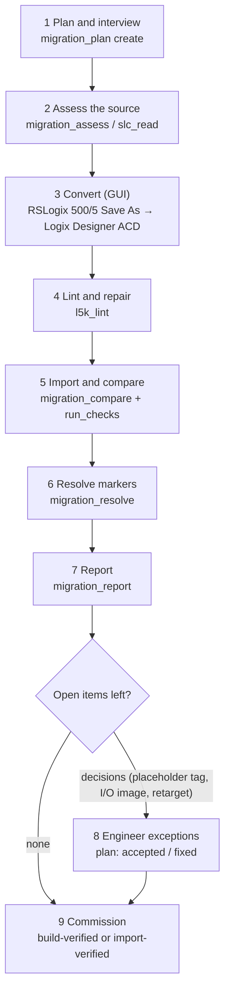

# SLC 500 and PLC-5 to Logix migration

The `migration` row is a support row for one job: bringing an RSLogix 500
(SLC 500) or RSLogix 5 (PLC-5) program into Studio 5000 with evidence instead of
hope. It adds seven tools and the `legacy-to-logix-migration` skill. It never
drives Studio or a controller; the one vendor call it makes opens RSLogix 500
(or RSLogix 5 for a PLC-5 `.RSP`) hidden, reads the project and closes it
without saving.

## End-to-end flow

| Stage | Gate to leave it | Artifact it leaves |
|---|---|---|
| intake | all five decisions answered | `plan.json` with source hash |
| assess | headless read or lint completed | risk list, counts |
| convert | wizard wrote an `.ACD` (engineer's choices) | `.ACD`, optional `.l5k` |
| lint | no `error` findings | repaired `.L5K` copy |
| import | project opens in Studio | `.L5X` export |
| compare | every real difference named | comparison table |
| engineer | each exception `accepted` or `fixed` | corrected `.L5X`, plan evidence |
| commission | acceptance bar met (rev 37+ build, or import-verified) | `.docx`/`.md` report + golden trio |

## Tools

| Tool | Reads | Answers |
|---|---|---|
| `migration_plan` | `.migration/plan.json` | the interview decisions, the stage evidence and the exceptions, in one resumable file |
| `migration_assess` | `.L5K`, `.SLC`, `.RSS`, `.ACH`, `.RSP` | what the file is, which controller it describes, and what a migration still has to change |
| `l5k_lint` | `.L5K` | will Studio import this file, and what will bite after it does |
| `slc_read` | `.RSS`, `.ACH`, `.RSP` | program files, rung counts, rung text, symbols and data files read headlessly through the 32-bit RSLogix 500 or RSLogix 5 automation server |
| `migration_compare` | `.RSS`, `.ACH`, `.RSP` + `.L5X` | which legacy ladder files reached which routines, how many rungs survived, which symbols and data files were carried, and which differences are real |
| `migration_resolve` | `.RSS`, `.ACH`, `.RSP` + `.L5X` | every `PCE` marker and every `?` operand in the converted ladder, the legacy instruction behind each, and a proposed replacement marked mechanical or review |
| `migration_report` | `.RSS`, `.ACH`, `.RSP` + `.L5X` (and optionally the corrected `.L5X`) | the report a person signs off from: the two programs side by side, the census before and after, the corrections rung by rung, and the open items that need a decision |

`migration_assess` on an `.L5K` returns the lint verdict too. `l5k_lint` exists
separately because the finding list is the repair worklist: rule, severity and
1-based line, ordered by line.

`slc_read` is the only tool here that starts another program, and even it opens
the project hidden, reads it and closes it without saving: no window, no click,
no change to the customer's file. It needs RSLogix 500 (for `.RSS`/`.ACH`) or
RSLogix 5 (for `.RSP`) on a 32-bit-capable host; without it, Save As `.SLC` and
read the export instead. On a staged PLC-5 program it returned 53 program files
(38 ladder), 358 rungs, 2,206 symbol records and 141 data files in a few seconds.

`migration_compare` reads the legacy side the same headless way. It treats a
file's terminal `END` rung as the end marker, not as logic, and it only expects
data files of type `I`, `O` and `S` to become tags if the conversion carried
them; on Slitter 8 that moved 3,409 symbol records and 209 data files to 64
matched files, 1,398 of 1,426 legacy rungs, 2 real differences and 2 expected
ones, with 259 indirect expressions left for engineering.

A data file whose header names no type at all — a PLC-5 file the reader cannot
label, so `B3` and `T4` style records arrive with an empty type — is left out of
the data-file check rather than reported unmapped. The wizard's tag spelling for
such a file is not predictable, so calling it "missing" would be a guess. On the
staged EN049 PLC-5 program that yields 34 matched files, 306 of 320 legacy
rungs, 90 data files all accounted for, 1 real difference (131 indirect
expressions) and 2 expected ones (6 added routines and 1 split rung).

`migration_resolve` answers the conversion's own error markers instead of only
counting them. The wizard writes `PCE(code,label)` where it could not translate
an instruction and `?` where it could not type an operand; the EN049 export
carries 177 markers across 76 of its 331 rungs and 54 rungs with an unknown
operand. The resolver pairs each rung with the legacy rung it came from and
classifies the site by what that legacy rung still records:

- the same instructions, in the same order, are already in the migrated rung:
  delete the marker. The proposal is the rung without it.
- a `?` stands for a timer or counter structure whose preset and accumulator
  the legacy rung still names (`TON{ T4:3, 0.01, 50, 50 }`): the proposal is
  `TON(T4[3])` with `T4[3].PRE := 0.5 s`, and a rung whose every unknown is
  answerable carries the whole replacement text.
- `PCE(116,…)` before `FOR` is review: the loop index was a status word, so the
  project needs a DINT tag the wizard did not declare, and a made-up tag name
  fails the import rather than proving anything.
- `PCE(150,…)` or `PCE(210,…)` before `MSG` is review: a BTW/BTR became a MSG,
  and the block's rack, group, slot, control, table and length have to be set on
  that instruction.
- `PCE(152,…)` alone on a rung is review: a status word has no Logix
  equivalent, so the rung is deleted and its job moved to the status the
  controller already keeps.
- an unknown operand the legacy rung does not record (a `FAL` or `CPT`
  expression the wizard flattened) is review, naming what is missing.

On EN049 that classified 214 sites, 201 of them answerable from the rung texts
alone and 35 for review. Applying the answerable ones took 65 rung rewrites, 37
operand repairs and one status-word rung removed, which took the export from 177
markers to 22 and from 54 rungs with `?` to 9. The rewritten file imports into
Studio 5000 with 0 warnings and 0 errors. The 22 markers left sit in 8 rungs and
are review by construction — MSG parameters, the loop index, DIV and CPT
expressions. The vendor build still stops at `RxCMP_E_AUDIT_OUTPUTS` (an
instruction touching the right power rail that is not an output) on that file,
and on the wizard's own export before any rewrite, so that audit is not this
resolver's to answer: a rung-level and branch-level scan of both files finds no
rail violation.

An RSLogix 500 program answers the same way, with its own code numbers: on
`SLITTER10_PLC1S0_08JUL2026_0953.RSS` the export carried 15 markers across
55 rungs and 50 rungs with an unknown operand, numbered 105, 109, 110, 114, 134,
135 and 160 rather than the PLC-5 set. Every one of those 65 sites was answerable
from the legacy rungs — 11 rung rewrites and 44 operand repairs — taking the
export to no markers and no unknown operands, and that file imports with 0
warnings and 0 errors. Its build stops later, at `RxCMP_E_AUDIT_INVALIDOPTYPE`,
which the SDK reports without naming the instruction.

`migration_report` turns those facts into the document a customer reads. It pairs
the legacy project, the wizard's `.L5X` and — when it exists — the corrected
`.L5X`, then writes one file: the two programs side by side, the marker census by
code with the legacy instruction behind each site, the corrections rung by rung
(only the text around each change), the comparison in full, and a section of open
items that are decisions rather than defects — a placeholder tag standing in for a
module with no Logix equivalent, a legacy I/O image left as a plain tag array, an
array indexed by a tag, sites still unanswered, legacy files with no counterpart,
and a revision below 37. Name the output `.docx` and it is a formatted Word
document (A4, banded tables, page numbers, no dependency and no vendor
application); name it `.md` and it is the same content as plain text. On
`SLITTER10_PLC1S0_08JUL2026_0953.RSS` the report reads 15 markers before and 0
after, 55 rungs corrected, and 3 open items: the `SLOT12_1747_SDN_Placeholder`
tag with its 33 logic references, `F[N7_120]` as a mechanical alias substitution,
and the revision-31 ceiling the wizard left.

`migration_plan` writes `.migration/plan.json` (schema 1): the project and source
hash, five decisions (`target_cpu`, `target_revision`, `io_strategy`,
`hmi_scope`, `acceptance`), eight stages (`intake`, `assess`, `convert`, `lint`,
`import`, `compare`, `engineer`, `commission`), and exceptions with a status of
`open`, `accepted` or `fixed`. A plan refuses to advance until every decision is
answered, and `next_action` names the one thing to do next.

## Formats

| Extension | What it is | What the row does |
|---|---|---|
| `.L5K` | the text the migration wizard writes and Studio imports (UTF-16LE from Studio, UTF-8 after a hand repair) | decodes either encoding, reads declarations, lints the text |
| `.SLC` | RSLogix 500 text export: `LADDER n`, `% Rung: n %`, SLC ASCII mnemonics, `DATA B3:0` tables | counts ladder files, rungs, racks and data files; read-only truth for the old logic |
| `.RSS`, `.ACH`, `.RSP` | OLE2 containers RSLogix 500 (`.RSS`, `.ACH`) or RSLogix 5 (`.RSP`) owns | `slc_read` opens them hidden and returns program files, rung text, symbols and data files; `migration_assess` states what the container is and what a conversion still needs |

An `.L5X` is refused with `ALREADY_LOGIX`: it is the Logix side, read with
`open_project`.

## Lint rules

| Rule | Severity | What it means |
|---|---|---|
| `TRAILING_COMMA` | error | an attribute list ends with a comma before `)`; Studio aborts the whole import as invalid attribute syntax |
| `DUPLICATE_TAG` | error | a tag name is declared twice in the TAG block |
| `TAG_NAME_TOO_LONG` | error | a name is over 40 characters |
| `ROUTINE_PAREN` | warning | a routine header ends with a stray `)` |
| `ROUTINE_UNBALANCED` | error | ROUTINE and END_ROUTINE counts differ: truncated or malformed |
| `PLACEHOLDER_TAG` | warning | a tag stands in for a module with no Logix equivalent (a 1747-SDN, say): correct output, and the replacement is an engineering decision |
| `INDIRECT_ADDRESS` | warning | a rung indexes an array with another tag (`N[N7_130]`), which Logix cannot express |
| `REVISION_BELOW_TARGET` | info | the controller revision is below 37, so only an import can be proven |
| `BOM` | warning | the file starts with a byte-order mark |

## Workflow

1. **Plan and interview.** `migration_plan create` starts the plan; answer the
   five decisions. Target controller and firmware, I/O strategy (keep the 1746
   chassis behind a 1747-AENTR or replace it), HMI scope and the acceptance
   bar. The skill asks; nothing assumes a default.
2. **Assess the source** with `migration_assess`. For an `.RSS` or `.RSP`,
   `slc_read` lists the program files, rung counts, symbols and data files
   headlessly first, so the estimate and the later comparison use the real
   structure.
3. **Convert.** RSLogix 500's (or RSLogix 5's) migration wizard — File > Save
   As, save-as-type "Logix Designer Files (\*.ACD)" — asks two questions. First
   the target: ControlLogix or CompactLogix, catalogue number and revision. The
   wizard cannot emit anything newer than the revisions it ships with — 30 to 31
   in the RSLogix 500 wizard, 30 to 32 in the RSLogix 5 one — which is a limit of
   the tool, not a choice; the project is retargeted to 37 or newer in Studio 5000
   before any offline build is claimed. Then the I/O strategy:
   **Keep Existing I/O** places the new controller in a rack beside a single
   EN2T or embedded Ethernet port and leaves the legacy chassis in a separate
   rack, while **Update All I/O** maps each legacy module to a replacement from
   the drop-down list. A module with no Logix equivalent becomes a placeholder
   tag — a 1747-SDN DeviceNet scanner, for instance — and that is the correct
   outcome, reported as `PLACEHOLDER_TAG`: the tag keeps the addresses compiling
   until an engineer chooses the replacement. The wizard writes a `.l5k` while it
   exports and
   removes it once the `.ACD` is written, so keep a copy if the lint report is
   wanted, and export the `.ACD` to `.L5X` for the comparison. `Failed to export
   to ACD` is a lint result, not a dead end.
4. **Lint and repair** the `.L5K` with `l5k_lint`. Repair a copy; never the
   customer's `.RSS` or the wizard's first output.
5. **Import and compare.** Open the imported `.L5X`, run `migration_compare`,
   then `run_checks`. Triage by migration cause: duplicated rung outputs are
   expected when several legacy files land in one routine; a missing routine, a
   lost rung or an indirect expression is real work.
6. **Resolve the conversion's markers** with `migration_resolve`, and apply each
   mechanical proposal with `draft_rung` or `compose_rung` — the marker deleted,
   the timer or counter structure filled from the legacy operand list, the whole
   rung replaced when the resolver offers one. Re-import and confirm the count
   fell; the review sites (MSG parameters, loop index, flattened expressions)
   stay in the plan as exception work.
7. **Write the report** with `migration_report`, naming a `.docx` for the Word
   document or `.md` for plain text: the census before and after, the corrections
   rung by rung, and the open items a person decides (the placeholder tag and its
   replacement module, the I/O image that has no owner yet, the array indexed by a
   tag, the revision retarget).
8. **Engineer the exceptions**, recording each in the plan as `accepted` or
   `fixed`, with the rung or project that proves it. Resolve indirect addressing
   and unmapped modules; a revision 37 or newer target allows an offline build
   proof.
9. **Commission against the plan's acceptance bar**: build-verified or
   import-verified, every difference explained, and the golden trio (`.RSS`,
   `.L5K`, `.L5X`) archived together with the report.

## What it knows without research

The row carries its own answers, so a session does not go looking for a vendor manual mid-migration. Two
layers, both local:

- **The instruction map** — `packages/migration/src/knowledge/instructions.ts`, one row per legacy mnemonic
  (58 of them) with the Logix candidate, the operand shape, a work class and a citation. `migration_assess`
  names the replacement beside each `LEGACY_INSTRUCTION` it counts (`IIM x1 -> no Logix counterpart`,
  `PID x1 -> PID`), and `migration_resolve` appends the row to the advice of every review site, so
  `PCE(150,PCE028)` arrives with `BTW -> MSG (review): … Basis: PLC-5 Instruction Set Reference 1785-6.1 …`.
- **The corpus pages** — `packages/resources/corpus/migration/` (seven pages, domain `migration`), read with
  `engineering_reference`: `migration-pce-markers` (the code table and what each code means),
  `migration-wizard-and-revisions` (the 30–31 and 30–32 ceilings, why a retarget precedes any build verdict),
  `migration-placeholder-tags` (what a placeholder tag is, and the `1747-SDN` → `1756-DNB` case),
  `migration-unknown-operands`, `migration-indirect-addressing`, `migration-instruction-map` and
  `migration-arrival-points`.

Citations name a manual and its section — *SLC 500 Instruction Set Reference Manual* 1747-RM001, *PLC-5
Instruction Set Reference* 1785-6.1, *Logix 5000 Controllers General Instructions Reference Manual*
1756-RM003 — or say `observed` and name the export that showed it. No manual text is reproduced, and a rule ID
such as `MIGRATION-PCE-02` is this bundle's own, not a clause number.

## Limits

- A text reader cannot prove runtime behaviour, I/O wiring or HMI bindings.
- A revision 37 or newer target supports an offline build proof; older targets
  support an "import succeeded" statement only. The wizard is the ceiling on
  that: it cannot emit revision 37 or newer at all, so its output is
  import-verified until the project is retargeted in Studio 5000 revision 37 or
  later — one setting, and the first step before a build verdict is quoted.
- Conversion itself is the wizard, not this row: `SaveAs` through the automation
  API writes a native copy, and the translator DLLs are undocumented.
- `migration_resolve` proposes; it never writes to the project. A mechanical
  proposal is only mechanical because the legacy rung still records what the
  wizard dropped — where it does not, the site is review, and a made-up tag or
  operand fails the import instead of proving the conversion.
- `migration_report` writes the report and nothing else; it reads the legacy
  project and both exports, and its Word output carries no runtime claim the
  Markdown copy does not.
- Nothing in this row contacts a controller or writes a live tag.
- A build error gets three probes, not a session. One hypothesis per build; when
  the third does not move the error, the finding is written down — what the error
  survived, the routine and rung the bisect narrowed it to — and handed on. The
  vendor's own Errors tab names the rung the SDK message withholds.

## Related

- [Tool reference](tools.md) — the generated entry for these tools.
- [Standards checks](standards-checks.md) — the `run_checks` rules used to
  triage the imported project.
- `docs/port/l5x.md` — the L5X package's own port notes.
